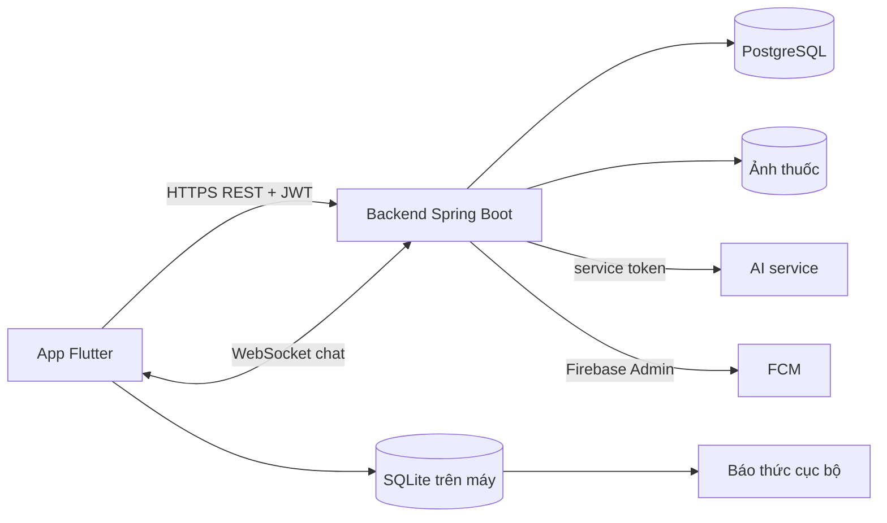

# An Tâm – Nhắc bố mẹ uống thuốc

Ứng dụng giúp người già uống thuốc và tập thể dục đúng giờ, và giúp các con cùng theo dõi trong một nhóm gia đình.

- **Bố mẹ:** đến giờ, điện thoại đổ chuông kể cả khi mất mạng hoặc vừa khởi động lại. Màn hình hiện ảnh viên thuốc và đọc tên, liều, mô tả bằng giọng tiếng Việt cho đến khi được xác nhận. Sau đó máy hỏi "có vấn đề gì không".
- **Các con:** xem bố mẹ đã uống chưa, nhận cảnh báo, đánh dấu giúp, xem lịch tuần và tháng, chat trong nhóm. Thêm thuốc bằng tay hoặc **Quét OCR** toa thuốc, vỏ hộp, hóa đơn.

> Đồ án môn Mobile App. App là công cụ nhắc lịch, không tư vấn y khoa. Máy của bố mẹ cần là điện thoại Android; các con dùng Android hoặc iPhone (iPhone chưa thử, xem docs/IPHONE.md).

## Thành phần

| Thư mục | Công nghệ | Vai trò |
|---|---|---|
| `app/` | Flutter (Dart), phần báo thức viết bằng Java | App cho người già, người con, admin |
| `backend/` | Java 25, Spring Boot 4, PostgreSQL, Flyway | API REST + JSON, WebSocket chat, hàng đợi thông báo |
| `ai-service/` | Python 3.13, FastAPI | Tách thông tin thuốc từ chữ OCR (chỉ backend gọi) |
| `shared/test-vectors/` | JSON | Bộ dữ liệu kiểm thử dùng chung cho Dart và Java |
| `scripts/` | Python, PowerShell | Dữ liệu demo giả, sao lưu |
| `docs/` | Markdown | Kế hoạch, quyết định, cài đặt, báo cáo kiểm thử, báo cáo môn học |

Các thư mục `mobile/`, `public/`, `server.py`, `prescription.py`, `database/` là **bản mẫu cũ** (Expo + Python), giữ lại cho đến khi nhóm đồng ý lưu trữ.



## Chạy nhanh (Windows)

Cần: Docker Desktop, Flutter SDK, Android Studio với máy ảo hoặc điện thoại Android. Hướng dẫn cài từng thứ ở [docs/SETUP.md](docs/SETUP.md).

**1. Cấu hình bí mật** (một lần):

```bash
copy .env.example .env
```

Mở `.env`, điền `DB_PASSWORD`, `AI_SERVICE_TOKEN`, `JWT_SECRET`, `CODES_SECRET` (mỗi giá trị là một chuỗi ngẫu nhiên dài, ít nhất 32 ký tự với 2 khóa JWT và mã). File `.env` không lên Git.

**2. Chạy backend, database, AI:**

```bash
docker compose up -d --build
```

Kiểm tra <http://localhost:8080/api/health> phải thấy `"status":"UP","ai":"UP"`.

**3. Dữ liệu demo giả** (tùy chọn):

```bash
python scripts/seed_demo.py
```

**4. Chạy app** trên máy ảo (máy ảo gọi laptop qua `http://10.0.2.2:8080`, đã là mặc định):

```bash
cd app && flutter run
```

Trên điện thoại thật: mở đường hầm HTTPS (`cloudflared tunnel --url http://localhost:8080`), rồi trong app bấm **Cài đặt máy chủ** và dán địa chỉ `https://...trycloudflare.com`.

Nếu build Android báo "Unable to delete directory", dùng `powershell -ExecutionPolicy Bypass -File app\tool\build_apk.ps1` (xem SETUP).

## Dùng thử

1. Máy người con: **Tôi là người con → Đăng ký**, tạo nhóm, **Cài đặt → Thêm bố / mẹ → Mã ghép máy**.
2. Máy người già: **Tôi là bố / mẹ**, nhập mã 6 số. Mở **Kiểm tra máy** để bật đủ quyền báo thức.
3. Người con: tab **Lịch → Thêm thuốc** (nhập tay hoặc **Quét OCR**), chụp ảnh viên thuốc, đặt giờ.
4. Đến giờ, máy người già báo; xác nhận và trả lời câu hỏi. Người con thấy kết quả ở tab **Hôm nay** và tin trong tab **Nhóm**.

## Kiểm thử

```bash
cd backend && mvnw test
```

```bash
cd app && flutter analyze && flutter test
```

```bash
cd ai-service && .venv\Scripts\python -m pytest -q
```

Backend dùng Testcontainers (cần Docker đang chạy). Kết quả từng giai đoạn: [docs/TEST_REPORT.md](docs/TEST_REPORT.md). Đánh giá OCR: [ai-service/evaluation/REPORT.md](ai-service/evaluation/REPORT.md).

## Tài liệu

- [docs/SKILL_AN_TAM.md](docs/SKILL_AN_TAM.md): kế hoạch và tiêu chí nghiệm thu từng giai đoạn.
- [docs/DECISIONS.md](docs/DECISIONS.md): các quyết định kỹ thuật và lý do.
- [docs/SETUP.md](docs/SETUP.md): cài đặt, đường hầm, Firebase, admin, sao lưu, APK phát hành.
- [docs/demo-script.md](docs/demo-script.md): kịch bản demo nghiệm thu.
- [docs/IPHONE.md](docs/IPHONE.md): iPhone làm được và không làm được (người con dùng được, máy người già cần Android).
- [docs/report/BAO_CAO.md](docs/report/BAO_CAO.md): bản nháp báo cáo môn học.

## Bảo mật

Không đưa lên Git: `.env`, `secrets/`, `google-services.json`, keystore, `key.properties`, `backups/`, ảnh và dữ liệu thật. Chỉ dùng dữ liệu giả trong demo và ảnh chụp màn hình.
