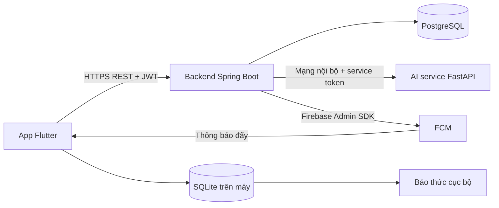

# Xây dựng hoàn chỉnh app An Tâm

> **File này đã cũ, không dùng nữa.** Kế hoạch hiện hành nằm ở `docs/SKILL_AN_TAM.md`.

## 1. Vai trò và cách làm việc

Bạn là kỹ sư full-stack cấp cao về mobile, làm việc theo kế hoạch của một project manager nhiều kinh nghiệm. Nhóm gồm 3 sinh viên làm đồ án môn Mobile App. Giao tiếp bằng tiếng Việt, giải thích ngắn gọn để sinh viên tự bảo vệ được đồ án. Code, tên biến và commit dùng tiếng Anh; chữ hiển thị trên app dùng tiếng Việt có dấu.

Quy tắc bắt buộc:

1. **Làm đúng một giai đoạn mỗi lần.** Xong giai đoạn thì dừng, báo cáo theo mục 13 và chờ nhóm xác nhận.
2. **Đọc tài liệu chính thức trước khi dùng API hoặc thư viện.** Không dựa vào trí nhớ. Dùng bản ổn định mới nhất và khóa phiên bản.
3. **Chỉ báo "xong" khi đã kiểm chứng.** Ghi rõ đã thử trên emulator hay máy thật, và phần nào chưa thử được.
4. **Không xóa code cũ** trong `mobile/`, `public/`, `server.py`, `prescription.py` trước Giai đoạn 11.
5. **Không đưa bí mật lên Git:** `google-services.json`, `.env`, service account, keystore, JWT secret, dữ liệu sức khỏe thật.
6. **Commit nhỏ, theo Conventional Commits.** Chỉ commit, push hoặc mở PR khi nhóm yêu cầu.
7. **Gặp mâu thuẫn hoặc thiếu thông tin ảnh hưởng đến kiến trúc thì hỏi.** Việc nhỏ thì chọn phương án hợp lý và ghi vào `docs/DECISIONS.md`.
8. **Công nghệ ở mục 3 đã được nhóm chốt.** Không tự đổi. Nếu phát hiện rủi ro nghiêm trọng, báo cáo kèm bằng chứng và phương án thay thế để nhóm quyết định.

## 2. Bối cảnh sản phẩm

**An Tâm** giúp người con ở xa biết bố mẹ đã uống thuốc và tập thể dục chưa.

| Vai trò | Nhu cầu chính | Nguyên tắc giao diện |
|---|---|---|
| Bố mẹ (người già) | Được nhắc đúng giờ, nghe giọng tiếng Việt, xác nhận thật dễ | Cực đơn giản, chữ rất to, mỗi màn hình một việc chính |
| Người con | Xem tình trạng, quản lý thuốc, lịch, sức khỏe | Đầy đủ chức năng, nhiều thông tin nhưng rõ ràng |
| Admin | Quản lý tài khoản, xem thống kê | Màn hình quản trị đơn giản ngay trong app |

**Giá trị cốt lõi cần bảo vệ:** điện thoại của bố mẹ phải báo đúng giờ kể cả khi không có mạng, server đang lỗi, app đã bị đóng, màn hình đang khóa hoặc máy vừa khởi động lại. Vì vậy **báo thức không được phụ thuộc vào backend hay AI** tại thời điểm báo.

**Hiện trạng repo:** đã có bản mẫu gồm app Expo (`mobile/`), server Python (`server.py`, `prescription.py`), SQLite (`database/schema.sql`) và web (`public/`). Dùng làm **tài liệu nghiệp vụ** khi cần đối chiếu hành vi. Không dịch code theo từng dòng.

## 3. Công nghệ đã chốt

| Phần | Công nghệ | Ghi chú |
|---|---|---|
| App | **Flutter, ngôn ngữ Dart**, Material 3 | Tạo bằng `flutter create -a java` để phần Android gốc viết bằng Java. Phát triển trong Android Studio |
| Quản lý trạng thái, điều hướng | Riverpod, go_router | Chọn một cách và dùng nhất quán |
| Gọi API | dio, mã model sinh từ OpenAPI hoặc viết tay có test | |
| Dữ liệu trên máy | drift (SQLite), flutter_secure_storage | Lịch báo thức, hàng đợi xác nhận offline, token |
| Báo thức | Chọn sau thử nghiệm ở Giai đoạn 2 | So sánh gói `alarm`, `flutter_local_notifications` và code Java gốc qua platform channel |
| Giọng đọc, nghe | flutter_tts, speech_to_text | Kiểm tra giọng tiếng Việt và phát qua luồng âm thanh báo thức |
| OCR | google_mlkit_text_recognition (Latin), chạy trên máy | Tiếng Việt thuộc nhóm ML Kit hỗ trợ. Plugin do cộng đồng duy trì nên phải thử sớm |
| Backend | **Java (bản LTS), Spring Boot**, Spring Security, Spring Data JPA | API REST, mô tả bằng OpenAPI |
| CSDL | PostgreSQL, Flyway | Mọi thay đổi cấu trúc đi qua migration |
| Thông báo đẩy | Firebase Cloud Messaging qua Firebase Admin SDK cho Java | Chỉ dùng Firebase cho FCM, không dùng Firestore |
| AI | **Python, FastAPI**, pytest | Dịch vụ riêng, chỉ backend được gọi |
| Hạ tầng | Docker Compose trên laptop, mở ra Internet bằng đường hầm HTTPS | Đã chốt, xem giới hạn trong `docs/DECISIONS.md`. Địa chỉ server phải đổi được trong app |
| Kiểm thử | flutter_test, integration_test, JUnit 5, Testcontainers, pytest | |
| CI | GitHub Actions cho cả ba phần | |

**Lưu ý phân biệt ngôn ngữ:** giao diện viết bằng **Dart**, không phải Java. Java dùng cho backend và phần Android gốc nếu có.

**Nền tảng:** Android là mục tiêu nghiệm thu. iPhone là phần mở rộng tùy chọn ở Giai đoạn 12, vì báo thức trên iPhone yếu hơn: theo tài liệu gói `alarm`, khi app bị đóng thì chỉ còn thông báo, không đổ chuông. Không hứa iPhone báo thức như Android khi chưa thử thật.

**Ngoài phạm vi:** xuất bản lên cửa hàng, thanh toán, tư vấn y khoa, đọc toa viết tay, kết nối thiết bị đo, tự huấn luyện mô hình đọc chữ.

## 4. Kiến trúc



Nguyên tắc:

- App không gọi trực tiếp AI service hay database.
- Ảnh toa thuốc chỉ nằm trên điện thoại. OCR chạy trên máy, chỉ gửi **văn bản đã lọc thông tin cá nhân** lên backend.
- AI service lỗi thì app vẫn dùng được: chuyển sang nhập tay, các chức năng khác không bị ảnh hưởng.
- Backend lỗi thì báo thức và xác nhận vẫn hoạt động; xác nhận nằm trong hàng đợi và tự gửi lại sau.

## 5. Câu hỏi cần xác nhận trước khi code (Giai đoạn 0)

Hỏi nhóm các câu sau, rồi lưu vào `docs/DECISIONS.md`:

1. Giảng viên có **chấp nhận Flutter** và cách demo nào (máy ảo, máy thật, APK)? Có chấm riêng phần backend không? Nếu giảng viên không chấp nhận Flutter, **dừng lại và báo nhóm**.
2. **Hạn nộp** là ngày nào? Dùng để xếp giai đoạn và xác định phần cắt theo mục 12.
3. Điện thoại Samsung cụ thể là **đời máy và phiên bản Android** nào? Có thêm máy hãng khác hoặc iPhone không?
4. Mỗi người **đã có kinh nghiệm** gì với Flutter, Spring Boot, Python? Đã ai deploy backend chưa?
5. Backend sẽ chạy ở **đâu** khi demo, ai trả phí nếu có? Tra giá và giới hạn hiện hành, đề xuất 2 phương án. Chú ý dịch vụ miễn phí có thể ngủ khi rảnh, làm thông báo trễ. Tuyệt đối không để hạn nộp phát hiện ra vấn đề này.
6. Ai sở hữu **project Firebase** cho FCM?

## 6. Đặc tả nghiệp vụ

### 6.1 Tài khoản và ghép nối

- **Người con:** đăng ký bằng email và mật khẩu, băm bằng BCrypt hoặc Argon2. Có đổi và quên mật khẩu.
- **Bố mẹ:** không cần email. Ghép thiết bị với hồ sơ bằng mã do người con tạo.
- **Mã ghép nối:** 6 chữ số, hết hạn sau 15 phút, chỉ dùng 1 lần, backend giới hạn số lần thử theo IP và theo mã. Ghép xong, thiết bị nhận refresh token riêng; thiết bị cũ bị thu hồi.
- **Mời anh chị em:** dùng mã mời cùng cơ chế.
- **Phiên đăng nhập:** access token JWT ngắn hạn, refresh token xoay vòng, lưu dạng băm ở server, thu hồi được khi đăng xuất hoặc khóa tài khoản.
- **Admin:** tạo bằng cấu hình lúc triển khai, không có màn hình tự đăng ký.

### 6.2 Dữ liệu chính (PostgreSQL)

```text
users(id, role[ADMIN|CAREGIVER|ELDER], email, password_hash, display_name, phone, disabled, created_at)
elders(id, user_id, call_name, birth_year, phone, health_note, timezone, created_by, created_at)
elder_caregivers(elder_id, caregiver_id)
pairing_codes(id, code_hash, type, elder_id, created_by, expires_at, used_at, attempt_count)
refresh_tokens(id, user_id, device_id, token_hash, expires_at, revoked_at)
devices(id, user_id, fcm_token, platform, last_seen_at)
medications(id, elder_id, series_id, name, dosage, note, times, days_of_week, start_date, end_date,
            active, source[MANUAL|OCR], created_at)
exercises(id, elder_id, series_id, title, time, days_of_week, duration_min, note,
          start_date, end_date, active, created_at)
dose_logs(id, medication_id, elder_id, date, time, name_snapshot, dosage_snapshot, status[TAKEN|SKIPPED],
          source[BUTTON|VOICE|CAREGIVER], logged_at, logged_by, UNIQUE(medication_id, date, time))
exercise_logs(id, exercise_id, elder_id, date, time, title_snapshot, source, logged_at, logged_by,
              UNIQUE(exercise_id, date))
health_records(id, elder_id, type, value, value2, note, recorded_at, recorded_by)
alerts(id, elder_id, kind, created_at, resolved_at, resolved_by)
notification_outbox(id, dedupe_key UNIQUE, user_id, payload, status, created_at, sent_at)
```

Quy tắc:

- **Xác nhận phải idempotent:** gửi lại cùng thuốc, ngày, giờ không tạo bản ghi mới. Có sẵn cho trường hợp offline rồi đồng bộ.
- **Không lưu trạng thái "quên".** Trạng thái tính từ lịch và log.
- **Sửa giờ hoặc liều của thuốc đã có lịch sử:** đóng bản cũ (`end_date` = hôm qua), tạo bản mới cùng `series_id`. Lịch sử cũ không đổi.
- **Xóa thuốc:** xóa mềm.
- **Giờ giấc:** tính theo `timezone` của hồ sơ, mặc định `Asia/Ho_Chi_Minh`. Thời điểm lưu UTC.

### 6.3 Trạng thái một lần nhắc

| Điều kiện | Trạng thái |
|---|---|
| Có log | `TAKEN`, `SKIPPED` hoặc `DONE` |
| Chưa tới giờ | `UPCOMING` |
| Từ lúc tới giờ đến 60 phút sau | `DUE` |
| Quá 60 phút, chưa có log | `MISSED` |

Logic này tồn tại ở cả Dart và Java nên **hai bên dùng chung bộ dữ liệu kiểm thử** `shared/test-vectors/dose-status.json`. Phủ các mốc: đúng phút đến giờ, phút thứ 60, phút thứ 61, qua nửa đêm, ngày đầu và ngày cuối đợt thuốc, thuốc tạo sau giờ uống trong ngày (lần đó không tính là quên).

### 6.4 Bộ máy báo thức (Android)

Đây là phần rủi ro cao nhất.

- App tải lịch về SQLite, tính các lần báo trong **7 ngày tới**, gộp các lần cùng giờ. Việc báo chỉ dựa vào dữ liệu trên máy.
- Khai báo `USE_EXACT_ALARM` cho API 33 trở lên, `SCHEDULE_EXACT_ALARM` với `maxSdkVersion="32"`. Đọc lại tài liệu và chính sách hiện hành trước khi chốt.
- Android 14 trở lên: kiểm tra `canUseFullScreenIntent()`, không có quyền thì dẫn tới trang cài đặt. Không được cấp thì notification thường vẫn phải đổ chuông.
- Màn hình báo hiện trên màn hình khóa (`showWhenLocked`, `turnScreenOn`).
- Chuông và giọng đọc dùng luồng **USAGE_ALARM**, để vẫn nghe được khi âm lượng media bằng 0.
- Lặp chuông và giọng đọc mỗi 60 giây, **tối đa 10 lượt**, sau đó im lặng nhưng thông báo vẫn còn đến khi xác nhận hoặc hết hạn.
- "Nhắc lại sau 10 phút" tạo báo thức một lần.
- Tính lại khi: dữ liệu đổi, khởi động lại máy, cập nhật app, đổi múi giờ, đổi giờ máy, đổi quyền, đăng nhập, và worker định kỳ. Không tạo báo thức trùng, hủy được báo thức cũ.
- **Khi người con đổi lịch:** backend gửi FCM data message để máy bố mẹ tải lại ngay. Worker định kỳ là đường dự phòng. Không dùng FCM để đổ chuông.
- Có màn hình **Kiểm tra độ sẵn sàng** liệt kê quyền thông báo, báo thức, full-screen, giọng tiếng Việt, tối ưu pin, mỗi mục có nút dẫn tới đúng trang cài đặt. Có hướng dẫn riêng cho Samsung; hãng khác thêm nếu có máy để thử.

### 6.5 Màn hình bố mẹ

- Chữ thân từ 20sp, tiêu đề từ 32sp, nút chính cao từ 72dp, tương phản từ 7:1, không dùng thao tác vuốt hay giữ lâu.
- Trạng thái luôn có **biểu tượng + chữ + màu**.
- Dùng được với cỡ chữ hệ thống 200% và TalkBack.
- **Trang chính:** lời chào theo `call_name`, giờ hiện tại, thẻ lớn cho việc tiếp theo, danh sách việc hôm nay, nút **Gọi cho con**, nút **Tôi thấy không khỏe**.
- **Màn hình báo:** tên thuốc, liều, nút lớn **ĐÃ UỐNG RỒI** (hoặc **TÔI ĐI TẬP ĐÂY**), nút phụ **Nhắc lại sau 10 phút**.
- **Giọng đọc:** "{call_name} ơi, đến giờ uống thuốc rồi ạ. {tên thuốc}, {liều}. Uống xong, {call_name} bấm nút màu xanh hoặc nói: đã uống." Máy chưa có giọng tiếng Việt thì cảnh báo người cài đặt, không đọc bằng giọng tiếng Anh.
- **Xác nhận bằng giọng nói:** xin quyền micro kèm giải thích. Chỉ nghe sau khi đọc xong. Câu có "chưa" hoặc "không" thì **không** tính là đã uống. Khớp rõ ("đã uống", "uống rồi", "xong rồi") mới ghi `source = VOICE`. Khớp "lát nữa", "chờ chút" thì hoãn. Không chắc thì không ghi. Không có dịch vụ nhận dạng thì ẩn gợi ý nói.
- **Quá giờ:** có nút "Tôi đã uống" để ghi nhận. App **không** khuyên uống bù hay gộp liều.
- **Offline:** xác nhận vào hàng đợi, tự gửi lại khi có mạng, không hiện lỗi gây lo lắng.

### 6.6 Màn hình người con

Thanh điều hướng 4 tab:

- **Hôm nay:** chọn bố/mẹ, cảnh báo đỏ, tiến độ uống thuốc, số lần quên, buổi tập, huyết áp gần nhất, dòng thời gian trong ngày, đánh dấu giúp hoặc hoàn tác, gọi điện.
- **Lịch:** xem tuần và tháng, mỗi ngày có chấm trạng thái kèm nhãn trợ năng. **Bấm một ngày mở bottom sheet** gồm lịch của ngày và 3 lựa chọn: **Quét toa thuốc**, **Thêm thuốc**, **Thêm lịch tập**; ngày đã chọn là ngày bắt đầu. Có danh sách đơn thuốc và lịch tập để sửa.
- **Sức khỏe:** huyết áp, nhịp tim, đường huyết, SpO₂, nhiệt độ, cân nặng; biểu đồ theo thời gian; tô đỏ khi ngoài ngưỡng tham khảo; luôn có dòng "không thay cho chẩn đoán của bác sĩ".
- **Cài đặt:** quản lý hồ sơ bố mẹ, tạo mã ghép nối, mời người cùng theo dõi, đăng xuất, xóa tài khoản và dữ liệu.

**Thông báo cho người con:** bố mẹ báo không khỏe thì backend gửi FCM ngay. Tác vụ định kỳ của backend tìm lần quên và ghi vào `notification_outbox`, `dedupe_key` đảm bảo không gửi trùng. Máy bố mẹ tắt nguồn thì backend chỉ biết là "chưa xác nhận", nên nội dung phải viết đúng như vậy, không khẳng định người già đã quên.

### 6.7 Quét toa thuốc và AI

Luồng: chụp hoặc chọn ảnh → cắt ảnh → ML Kit đọc chữ trên máy → lọc các dòng thông tin cá nhân → backend → AI service → trả danh sách thuốc → màn hình **duyệt bắt buộc** → tạo lịch từ ngày đã chọn.

**Nhiệm vụ của AI service** là một việc duy nhất: `POST /v1/prescriptions/parse`, nhận văn bản, trả danh sách `{name, dosage, times, days, note, confidence}`.

**Các bước làm AI, theo thứ tự:**

1. **Bản nền:** chuyển `prescription.py` thành dịch vụ. Đây là mốc so sánh và là phương án dự phòng.
2. **Bộ dữ liệu đánh giá:** gán nhãn tối thiểu 30 toa in thật đã che thông tin cá nhân hoặc toa tạo mẫu. Không đưa toa thật lên Git. Chia riêng phần phát triển và phần kiểm tra.
3. **Thử mô hình:** thử một mô hình trích xuất thông tin (mô hình chạy cục bộ hoặc LLM). Nếu dùng dịch vụ AI bên ngoài, ghi vào `docs/DECISIONS.md` về nơi dữ liệu đi, chi phí, và cần nhóm đồng ý trước.
4. **Chỉ dùng mô hình nếu đo được tốt hơn bản nền** trên phần kiểm tra. Báo cáo độ chính xác theo từng trường: tên, liều, giờ, số ngày. Nếu không tốt hơn thì giữ bản nền và báo cáo trung thực; đây vẫn là kết quả hợp lệ cho đồ án.

**Yêu cầu an toàn:**

- Mỗi trường trên màn hình duyệt sửa được. **Không có đường tạo lịch nào bỏ qua bước duyệt.** Hiện ảnh gốc cạnh kết quả.
- Trường không chắc thì để trống và tô nổi bật. Không được suy đoán thông tin toa không ghi. Có test chống "tự bịa" thuốc hoặc liều.
- Không đưa ảnh lên server. Không ghi nội dung toa vào log.
- AI không đưa lời khuyên y khoa.
- Timeout rõ ràng. AI lỗi thì hiện form nhập tay.
- Giờ mặc định: sáng 07:30, trưa 11:30, chiều 16:30, tối 20:00; 2 lần/ngày là 07:30, 19:30; 3 lần là 07:30, 11:30, 19:30; 4 lần là 07:00, 11:00, 15:00, 20:00.

**Bộ kiểm thử bắt buộc** (bản nền hiện đạt được):

| Đầu vào | Tên | Liều | Giờ | Số ngày | Ghi chú |
|---|---|---|---|---|---|
| `1. Amlodipin 5mg  30 viên` / `Ngày uống 1 lần, mỗi lần 1 viên, sáng sau ăn` | Amlodipin 5mg | 1 viên | 07:30 | 30 | Uống sau ăn |
| `2) Metformin 500mg x 60 viên` / `Sáng 1 viên, Tối 1 viên, uống trong bữa ăn` | Metformin 500mg | 1 viên | 07:30, 20:00 | 30 | Uống trong bữa ăn |
| `3. Paracetamol 500mg  SL: 10 viên  Ngày 2 lần, mỗi lần 1 viên. Dùng 5 ngày` | Paracetamol 500mg | 1 viên | 07:30, 19:30 | 5 | |
| `4. Vitamin B1 B6 B12 hộp 30 viên - Ngày uống 1 lần` | Vitamin B1 B6 B12 | | 07:30 | 30 | |
| `5. Omeprazol 20mg 14 viên. Uống 1 viên/lần, 2 lần/ngày trước ăn 30 phút` | Omeprazol 20mg | 1 viên | 07:30, 19:30 | 7 | Uống trước ăn |
| `6. Losartan 50mg` / `Sáng: 1/2 viên` | Losartan 50mg | 1/2 viên | 07:30 | không rõ | |

Bổ sung: bản không dấu của các dòng trên; dòng hành chính ("Họ tên", "Chẩn đoán", "Lời dặn") không được thành thuốc; văn bản không có thuốc trả về danh sách rỗng.

### 6.8 Admin

Xem số người dùng, hồ sơ, cảnh báo chưa xử lý; tìm kiếm; khóa và mở khóa tài khoản. Admin **không xem được** chi tiết thuốc và sức khỏe, chỉ thấy số liệu tổng hợp. Khóa tài khoản phải thu hồi phiên đăng nhập.

## 7. Bảo mật và an toàn

- **Mọi endpoint kiểm tra quyền trên từng đối tượng:** người con chỉ truy cập hồ sơ mình theo dõi, bố mẹ chỉ ghi log của mình. Viết test tích hợp cho cả trường hợp được phép và bị từ chối, cho từng vai trò. Đây là tiêu chí nghiệm thu, không phải việc làm thêm.
- Validate đầu vào, giới hạn số lần đăng nhập, HTTPS khi triển khai. Bản release không cho phép HTTP; HTTP chỉ dùng trong bản debug nối máy local.
- Bí mật đặt trong biến môi trường. AI service không mở ra Internet, yêu cầu service token.
- App là công cụ nhắc lịch, không tư vấn y khoa, không đề xuất liều.
- Dữ liệu sức khỏe là dữ liệu nhạy cảm: thu thập tối thiểu, có màn hình đồng ý, có xóa tài khoản và dữ liệu. Không ghi dữ liệu sức khỏe vào log.
- Chỉ dùng dữ liệu giả trong demo, ảnh chụp màn hình và báo cáo.
- Đối chiếu Luật Bảo vệ dữ liệu cá nhân hiện hành nếu dùng ngoài phạm vi môn học.

## 8. Thiết kế giao diện

- Tạo hệ thống riêng trong `app/lib/core/theme`: màu, chữ, kích thước, khoảng cách, bo góc. Không viết giá trị trực tiếp trong màn hình.
- Font có đủ dấu tiếng Việt, ví dụ Be Vietnam Pro, đóng gói trong app.
- Hai chế độ mật độ: **Elder** (rất lớn, ít thành phần) và **Caregiver** (cân đối, nhiều thông tin).
- Nhóm thích app *Vesta Elder Care*. Chỉ học các **nguyên tắc** (thẻ lớn, ít lựa chọn, cảm giác ấm áp). **Không sao chép** tên, logo, hình minh họa, màu thương hiệu hay bố cục cụ thể của app đó.
- Dùng icon nhất quán thay vì emoji. Mọi màn hình có trạng thái rỗng, đang tải, lỗi và offline.
- Kiểm tra màn hình 5 inch, cỡ chữ 200%, TalkBack.

## 9. Cấu trúc repo

```text
app/                    Flutter
  lib/core/             theme, widgets, time, network
  lib/domain/           model, dose status, schedule expansion
  lib/data/             api, drift, repositories
  lib/reminder/         lập lịch báo thức, TTS, nghe giọng nói
  lib/features/         auth, pairing, elder, caregiver, ocr, admin
  android/              phần Android gốc (Java) nếu cần
backend/                Spring Boot
  src/main/java/vn/antam/  auth, elder, medication, exercise, health, alert, notification, ocr, admin
  src/main/resources/db/migration/
ai-service/             FastAPI
  app/, tests/, evaluation/
shared/test-vectors/    dữ liệu kiểm thử dùng chung
docs/                   DECISIONS.md, SETUP.md, TEST_REPORT.md, API, demo-script.md
docker-compose.yml      PostgreSQL, backend, AI service
```

Package Android: `vn.antam.app`. `minSdk` theo yêu cầu của các plugin đã chọn, ghi vào `docs/DECISIONS.md`.

## 10. Các giai đoạn

Dừng lại khi đạt tiêu chí nghiệm thu (DoD). Ước lượng: S = dưới 2 ngày, M = 2–4 ngày, L = trên 4 ngày, tính cho 1 người.

### Giai đoạn 0: Xác nhận và chuẩn bị (S)
Hỏi các câu ở mục 5. Viết `docs/SETUP.md`, cài Flutter, JDK, Docker, Python.
**DoD:** `flutter doctor` đạt yêu cầu Android; cả 3 người chạy được app Flutter trên máy ảo và Spring Boot, PostgreSQL, FastAPI qua Docker Compose; đã có câu trả lời và phương án hosting.

### Giai đoạn 1: Khung chạy xuyên suốt (M)
Tạo cấu trúc repo, CI, theme Elder/Caregiver, API `/health`, và **chạy backend trên laptop, mở ra Internet qua đường hầm HTTPS**. Chọn công cụ đường hầm sau khi đọc tài liệu. App trên máy thật dùng 4G gọi được backend, backend gọi được AI service, gửi được 1 thông báo FCM tới điện thoại.
**DoD:** CI xanh; trình diễn được toàn bộ chuỗi trên máy thật dùng 4G, không chung Wi-Fi với laptop. Rủi ro đường hầm và ghép nối được phát hiện từ đây.

### Giai đoạn 2: Thử nghiệm báo thức (M, rủi ro cao)
Bản thử dùng dữ liệu cứng, không cần backend. So sánh các phương án ở mục 3, chọn một và ghi lý do.
**DoD:** trên **máy Samsung thật**, báo lệch dưới 1 phút và có tiếng ở 6 tình huống: app mở; app ở nền; app bị vuốt tắt; màn hình khóa; chế độ máy bay; sau khi khởi động lại. Ghi vào `docs/TEST_REPORT.md`. Nếu thất bại, **dừng và báo cáo**.

### Giai đoạn 3: Tài khoản, ghép nối, phân quyền (L)
Đăng ký, đăng nhập, refresh token, hồ sơ bố mẹ, mã ghép nối, mã mời, màn hình tương ứng.
**DoD:** test tích hợp phân quyền đạt; ghép nối đúng trên 2 thiết bị; mã hết hạn, đã dùng hoặc thử quá số lần bị từ chối.

### Giai đoạn 4: Thuốc và trạng thái (M)
API và màn hình thuốc theo `series_id`, trạng thái, tính lịch, tải về máy, nối với báo thức, FCM báo đổi lịch.
**DoD:** test vector đạt ở cả Dart và Java; người con thêm thuốc thì máy bố mẹ báo đúng giờ; tắt mạng hoặc tắt backend vẫn báo.

### Giai đoạn 5: Trải nghiệm bố mẹ (L)
Trang chính, màn hình báo, giọng đọc, xác nhận giọng nói, hoãn, gọi con, báo không khỏe, xin quyền, kiểm tra sẵn sàng, hàng đợi offline.
**DoD:** xác nhận offline đồng bộ không trùng; thử TalkBack và cỡ chữ 200%; "chưa uống" không bị tính là đã uống; nếu có thể, 1 người từ 55 tuổi trở lên ngoài nhóm tự xác nhận được mà không cần hướng dẫn.

### Giai đoạn 6: Hôm nay và thông báo cho người con (M)
Tab Hôm nay, đánh dấu giúp, cảnh báo, tác vụ tìm lần chưa xác nhận, gửi FCM qua outbox. Khi backend khởi động lại, tác vụ phải quét bù khoảng thời gian bị tắt, không gửi trùng.
**DoD:** trạng thái cập nhật giữa 2 máy; thông báo đến khi app người con đóng, không trùng, có đo độ trễ; tắt rồi bật lại laptop vẫn phát hiện được lần chưa xác nhận.

### Giai đoạn 7: Lịch và lịch tập (M)
Lịch tuần, tháng, bottom sheet theo ngày, bài tập theo thứ, báo thức tập thể dục.
**DoD:** bấm một ngày mở đúng 3 lựa chọn; chấm trạng thái đúng; lịch thứ 2-4-6 chỉ xuất hiện đúng ngày và báo đúng giờ.

### Giai đoạn 8: OCR và AI (L)
OCR trên máy, lọc thông tin cá nhân, AI service theo các bước ở mục 6.7, màn hình duyệt.
**DoD:** bộ kiểm thử mục 6.7 đạt; có báo cáo so sánh bản nền và mô hình trên bộ dữ liệu đánh giá; không thể tạo lịch khi chưa duyệt; tắt AI service thì app vẫn nhập tay được.

### Giai đoạn 9: Sức khỏe và admin (M)
Ghi chỉ số, biểu đồ, ngưỡng; màn hình admin.
**DoD:** biểu đồ đúng dữ liệu; admin không đọc được thuốc và sức khỏe (có test); khóa tài khoản làm mất phiên đăng nhập.

### Giai đoạn 10: Hoàn thiện (M)
Xử lý lỗi và offline, đồng ý và xóa dữ liệu, sao lưu CSDL, lint, tăng coverage, APK release ký bằng keystore riêng, dữ liệu demo giả.
**DoD:** cài APK release trên máy sạch, nối backend qua đường hầm, chạy hết kịch bản nghiệm thu.

### Giai đoạn 11: Dọn dẹp và tài liệu đồ án (S)
Lưu trữ bản mẫu cũ **sau khi nhóm đồng ý**. README, sơ đồ kiến trúc, ERD, use case, tài liệu API, báo cáo kiểm thử và AI, phân công, giới hạn đã biết, slide, kịch bản demo.
**DoD:** thành viên mới clone repo và chạy được chỉ bằng README; có video demo dự phòng.

### Giai đoạn 12: iPhone (tùy chọn, chỉ làm khi còn thời gian)
Cần Mac hoặc dịch vụ build cloud, và tài khoản Apple Developer nếu cài lên máy thật. Thử trên iPhone thật và ghi rõ giới hạn báo thức.
**DoD:** app chạy được; tài liệu nêu đúng những gì iPhone làm được và không làm được.

**Kịch bản nghiệm thu cuối cùng (chạy trên 2 máy):** người con đăng ký → tạo hồ sơ → ghép máy bố mẹ → quét toa, duyệt, tạo 2 thuốc → thêm lịch tập → bật chế độ máy bay trên máy bố mẹ và tắt app → báo thức vẫn đổ chuông và đọc giọng tiếng Việt → xác nhận → bật mạng → máy người con thấy "đã uống" → bỏ qua một lần → người con nhận thông báo → bố mẹ báo không khỏe → người con nhận thông báo → khởi động lại máy bố mẹ → báo thức tiếp theo vẫn chạy → tắt AI service → app vẫn hoạt động, chỉ phải nhập tay.

## 11. Phân công gợi ý

| Người | Phụ trách chính | Hỗ trợ | Giai đoạn |
|---|---|---|---|
| A | Flutter, báo thức, trải nghiệm bố mẹ | Review backend | 1, 2, 5, 7 |
| B | Spring Boot, CSDL, phân quyền, FCM, deploy | Review Flutter | 1, 3, 4, 6, 9 |
| C | AI Python, OCR, kiểm thử, tài liệu | Review backend | 8, 11 và kiểm thử mọi giai đoạn |

Mọi người cùng làm Giai đoạn 10. Mỗi PR có 1 người khác review, để không ai là người duy nhất hiểu một phần. Điều chỉnh theo kinh nghiệm thực tế của nhóm ở câu 4 mục 5. Mỗi người phải giải thích được phần mình làm khi bảo vệ.

## 12. Nếu thiếu thời gian

Thứ tự cắt, từ cắt trước đến cắt sau:

1. iPhone (Giai đoạn 12)
2. Biểu đồ sức khỏe (giữ nhật ký dạng danh sách)
3. Admin nâng cao (giữ danh sách và khóa tài khoản)
4. Mô hình AI (giữ bản nền có quy tắc của AI service)
5. Xác nhận bằng giọng nói
6. Mời nhiều người con
7. Lịch tháng (giữ lịch tuần)

**Không được cắt:** báo thức đáng tin cậy, giọng đọc tiếng Việt, xác nhận và đồng bộ trạng thái, ghép nối an toàn, kiểm tra quyền trên từng đối tượng, bước duyệt của OCR, chạy được backend qua đường hầm để demo.

## 13. Mẫu báo cáo khi kết thúc giai đoạn

```text
## Giai đoạn N: <tên>
Đã làm:
Kết quả từng tiêu chí DoD: đạt / chưa đạt + bằng chứng (test, thiết bị, phiên bản Android)
Chưa kiểm chứng được:
Rủi ro hoặc giới hạn mới phát hiện:
Quyết định đã ghi vào docs/DECISIONS.md:
Nhóm cần làm:
Đề xuất giai đoạn tiếp theo:
```

## 14. Bắt đầu

Bắt đầu Giai đoạn 0: đọc repo để nắm nghiệp vụ, hỏi các câu ở mục 5, chưa viết code cho đến khi có câu trả lời.
