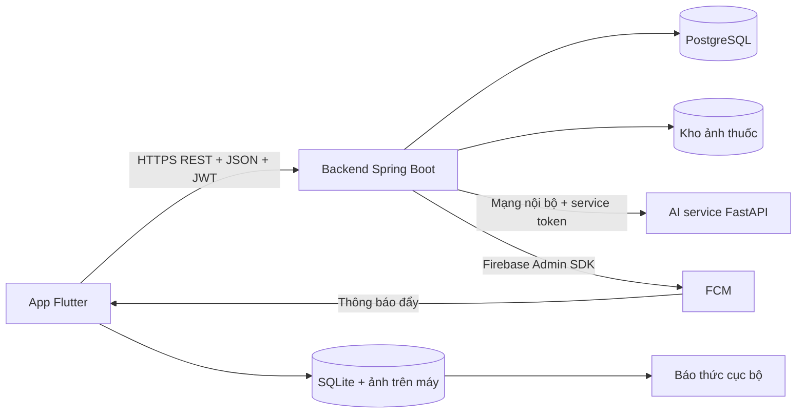
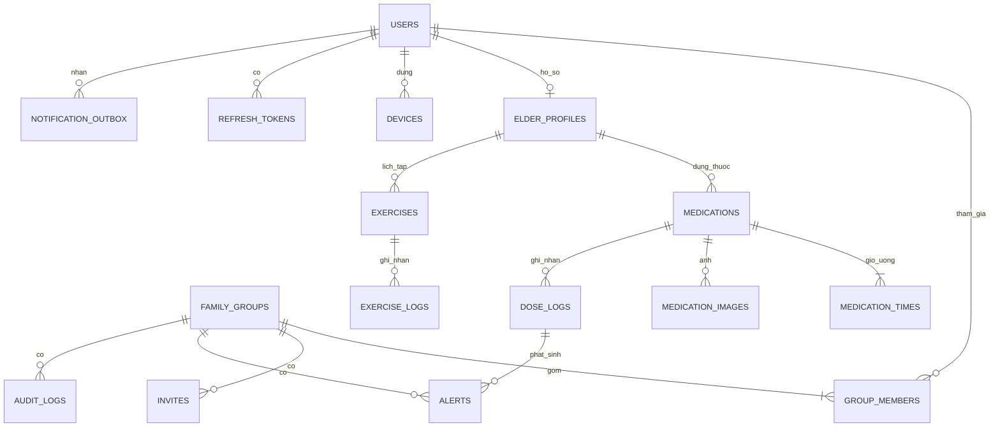
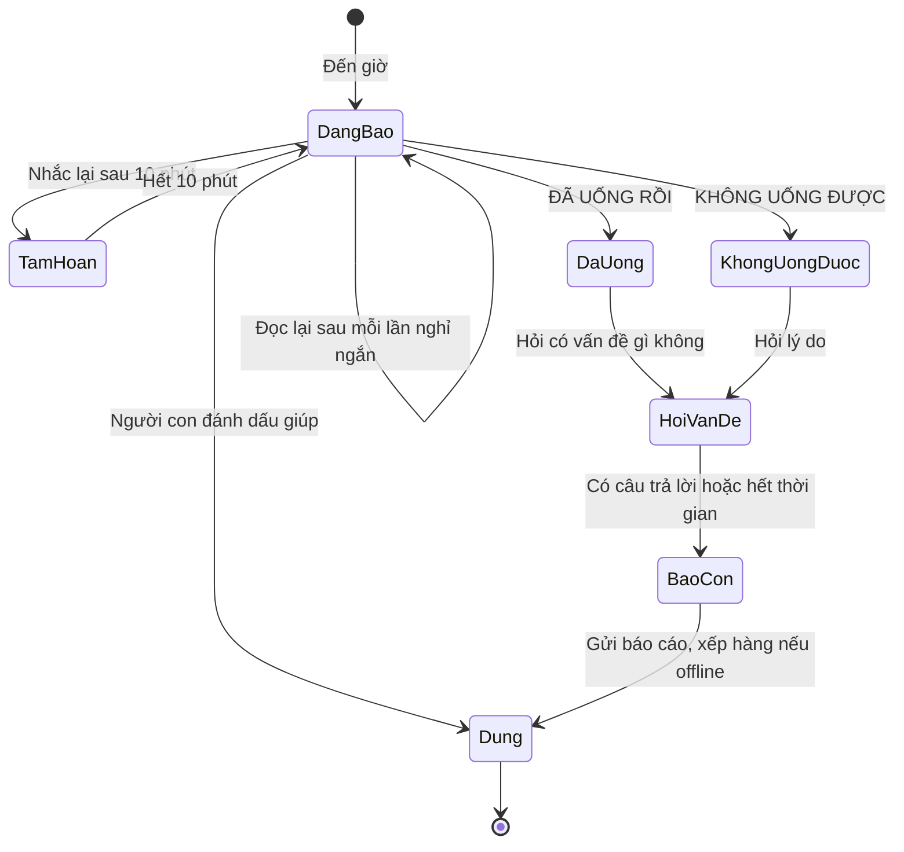

# Xây dựng app An Tâm

## 1. Vai trò và cách làm việc

Bạn là kỹ sư full-stack cấp cao về mobile, làm theo kế hoạch của một project manager nhiều kinh nghiệm. Nhóm gồm 3 sinh viên làm bài tập nhóm môn Mobile App. Giao tiếp bằng tiếng Việt, giải thích ngắn gọn để sinh viên tự bảo vệ được. Code, tên biến, commit dùng tiếng Anh; chữ trên app dùng tiếng Việt có dấu.

Quy tắc bắt buộc:

1. **Làm đúng một giai đoạn mỗi lần.** Xong thì dừng, báo cáo theo mục 15 và chờ nhóm xác nhận.
2. **Đọc tài liệu chính thức trước khi dùng API hoặc thư viện.** Không dựa vào trí nhớ. Dùng bản ổn định mới nhất và khóa phiên bản.
3. **Chỉ báo "xong" khi đã kiểm chứng.** Ghi rõ thử trên máy ảo hay máy thật, và phần chưa thử được.
4. **Không xóa bản mẫu cũ** (`mobile/`, `public/`, `server.py`, `prescription.py`, `database/`) trước khi nhóm đồng ý.
5. **Không đưa bí mật lên Git:** `.env`, `google-services.json`, service account, keystore, JWT secret, ảnh và dữ liệu thật.
6. **Chỉ commit, push hoặc mở PR khi nhóm yêu cầu.** Commit nhỏ, theo Conventional Commits.
7. **Không tự đổi công nghệ ở mục 3.** Phát hiện rủi ro nghiêm trọng thì báo cáo kèm bằng chứng và phương án thay thế.
8. **Việc cần tài khoản, quyền admin hoặc đồng ý điều khoản** do nhóm tự làm. Không đồng ý thay nhóm.
9. Việc nhỏ thì tự chọn và ghi vào `docs/DECISIONS.md`. Việc ảnh hưởng đến kiến trúc thì hỏi.

## 2. Sản phẩm

**An Tâm** nhắc người già uống thuốc và tập thể dục, đồng thời giúp các người con cùng theo dõi trong một nhóm gia đình.

| Vai trò | Quyền và nhu cầu | Giao diện |
|---|---|---|
| **Người già** (`ELDER`) | Được nhắc, phân biệt được thuốc qua ảnh và mô tả, xác nhận, báo vấn đề | Cực đơn giản, chữ rất to |
| **Trưởng nhóm** (`OWNER`) | Quyền cao nhất: đặt lịch, thêm, sửa, xóa thuốc, quản lý thành viên | Đầy đủ |
| **Thành viên** (`MEMBER`) | Người con khác: xem, nhận báo cáo, xử lý cảnh báo, đánh dấu giúp | Đầy đủ, không có nút sửa lịch |
| **Admin hệ thống** | Quản lý tài khoản, xem thống kê tổng hợp | Màn hình quản trị đơn giản |

**Giá trị cốt lõi:** điện thoại người già phải báo đúng giờ kể cả khi không có mạng, server lỗi, app đã đóng, màn hình khóa hoặc máy vừa khởi động lại. **Báo thức không được phụ thuộc vào backend hay AI tại thời điểm báo.**

**Đã bỏ khỏi phạm vi:** số đo sức khỏe (huyết áp, đường huyết...). Không tạo bảng, API hay màn hình cho phần này. Giữ nút "Tôi thấy không khỏe" vì đây là cảnh báo, không phải số đo.

**Ngoài phạm vi:** xuất bản lên cửa hàng, thanh toán, tư vấn y khoa, đọc chữ viết tay, tự huấn luyện mô hình đọc chữ, gọi thoại và video, **chat nhóm** (thầy chốt bỏ ngày 24/11/2026 vì không thiết thực).

## 3. Công nghệ đã chốt

| Phần | Công nghệ | Ghi chú |
|---|---|---|
| App | **Flutter (Dart)**, Material 3 | Phần Android gốc viết bằng Java. Phát triển trong Android Studio |
| Trạng thái, điều hướng | Riverpod, go_router | |
| Gọi API | dio | Giao tiếp **REST + JSON**, mô tả bằng OpenAPI. Không dùng gRPC |
| Dữ liệu trên máy | drift (SQLite), flutter_secure_storage | Lịch báo, hàng đợi offline, token. Ảnh thuốc lưu trong thư mục riêng của app |
| Báo thức | Chọn sau thử nghiệm ở Giai đoạn 2 | So sánh gói `alarm`, `flutter_local_notifications`, Java gốc qua platform channel |
| Giọng đọc, nghe | flutter_tts, speech_to_text | Phát qua luồng âm thanh báo thức |
| OCR | google_mlkit_text_recognition (Latin), chạy trên máy | Plugin do cộng đồng duy trì, phải thử sớm |
| Backend | **Java LTS, Spring Boot**, Spring Security, Spring Data JPA | |
| CSDL | **PostgreSQL**, Flyway | Mọi thay đổi đi qua migration |
| Lưu ảnh | Docker volume, tải về qua API có kiểm tra quyền | Không có đường dẫn công khai |
| Thông báo đẩy | Firebase Cloud Messaging | Chỉ dùng Firebase cho FCM |
| AI | **Python, FastAPI** | Chỉ backend được gọi |
| Hạ tầng | **Docker Compose trên laptop + đường hầm HTTPS** | Giới hạn xem `docs/DECISIONS.md`. Địa chỉ server đổi được trong app |
| Kiểm thử | flutter_test, integration_test, JUnit 5, Testcontainers, pytest | |
| CI | GitHub Actions | |

Android là mục tiêu nghiệm thu. iPhone là phần tùy chọn ở Giai đoạn 13.

## 4. Kiến trúc



Nguyên tắc:

- App không gọi trực tiếp AI service hay database.
- OCR chạy trên máy. Ảnh dùng để OCR **không** lên server, chỉ gửi **văn bản đã lọc thông tin cá nhân**.
- Ảnh nhận dạng thuốc **có** lên server để chia sẻ cho máy người già, và phải được tải sẵn về máy để xem được khi offline.
- AI lỗi thì chuyển sang nhập tay. Backend lỗi thì báo thức và xác nhận vẫn hoạt động, xác nhận nằm trong hàng đợi và tự gửi lại.

## 5. Nhóm gia đình và phân quyền

Mô hình nhóm gia đình: mỗi người có một tài khoản, một tài khoản có thể ở nhiều nhóm.

- Một nhóm gồm **1 trưởng nhóm**, nhiều người con và nhiều người già. Ví dụ một nhóm có cả bố, mẹ và 3 người con.
- **Một người con thuộc được nhiều nhóm**, ví dụ nhóm nhà mình và nhóm nhà vợ. App có bộ chuyển nhóm ở đầu màn hình.
- **Mỗi người già thuộc đúng 1 nhóm**, để không có hai trưởng nhóm đặt lịch trùng nhau.
- **Mỗi nhóm luôn có đúng 1 trưởng nhóm.** Trưởng nhóm muốn rời thì phải chuyển quyền trước. Nếu là người con duy nhất, rời nhóm đồng nghĩa với xóa nhóm, cần xác nhận rõ.
- Trưởng nhóm đặt lịch. Mọi thay đổi lịch được ghi lại ai đổi và lúc nào (`audit_logs`).

**Ma trận quyền** (viết test tích hợp cho từng ô):

| Hành động | Trưởng nhóm | Thành viên | Người già | Người ngoài nhóm |
|---|---|---|---|---|
| Xem thuốc, lịch, trạng thái trong nhóm | Có | Có | Chỉ của mình | Không |
| Thêm, sửa, xóa thuốc và ảnh; đặt lịch; quét OCR để tạo thuốc | Có | Không | Không | Không |
| Thêm, sửa, xóa lịch tập | Có | Không | Không | Không |
| Tạo mã ghép máy người già, sửa hồ sơ người già | Có | Không | Không | Không |
| Mời, xóa thành viên; chuyển quyền trưởng nhóm | Có | Không | Không | Không |
| Tự rời nhóm | Sau khi chuyển quyền | Có | Không | Không |
| Đánh dấu giúp "đã uống" hoặc hoàn tác | Có | Có | Không | Không |
| Xử lý cảnh báo | Có | Có | Không | Không |
| Xác nhận thuốc, trả lời câu hỏi, báo không khỏe | Không | Không | Chỉ của mình | Không |

Admin hệ thống **không** đọc được thuốc, ảnh hay trạng thái uống thuốc, chỉ thấy số liệu tổng hợp.

**Đăng nhập và ghép nối:**

- Người con: email và mật khẩu, băm bằng BCrypt hoặc Argon2. Có đổi và quên mật khẩu. Access token JWT ngắn hạn, refresh token xoay vòng, lưu dạng băm, thu hồi được.
- Người già: không cần email. Trưởng nhóm tạo hồ sơ, tạo mã 6 chữ số, nhập trên máy người già. Mã hết hạn sau 15 phút, dùng 1 lần, giới hạn số lần thử theo IP và theo mã. Ghép xong, thiết bị cũ bị thu hồi.
- Mời người con: mã mời hoặc link, thời hạn 7 ngày, dùng 1 lần.

## 6. Thiết kế cơ sở dữ liệu



```text
users(id PK, account_type[CAREGIVER|ELDER|SYSTEM_ADMIN], email UNIQUE NULL, password_hash NULL,
      display_name, phone, disabled, created_at)

family_groups(id PK, name, schedule_version, created_by FK, created_at, deleted_at)

group_members(id PK, group_id FK, user_id FK, role[OWNER|MEMBER|ELDER], joined_at, left_at)
  - Một người chỉ có 1 dòng đang hoạt động trong một nhóm
  - Mỗi nhóm đúng 1 OWNER đang hoạt động      (partial unique index)
  - Mỗi người già đúng 1 nhóm đang hoạt động  (partial unique index)

elder_profiles(user_id PK FK, group_id FK, call_name, birth_year, phone, health_note, timezone)

invites(id PK, kind[ELDER_DEVICE|MEMBER], code_hash, group_id FK, elder_user_id FK NULL,
        created_by FK, expires_at, used_at, attempt_count)
refresh_tokens(id PK, user_id FK, device_id FK, token_hash, expires_at, revoked_at)
devices(id PK, user_id FK, fcm_token, platform, last_seen_at)

medications(id PK, group_id FK, elder_user_id FK, series_id, name, strength, dosage, note,
            shape, color, imprint, pill_description, days_of_week, start_date, end_date,
            active, source[MANUAL|OCR_PRESCRIPTION|OCR_PACKAGE|OCR_INVOICE],
            created_by FK, created_at, updated_by FK, updated_at)
medication_times(id PK, medication_id FK, time_of_day, UNIQUE(medication_id, time_of_day))
medication_images(id PK, medication_id FK, kind[PILL|PACKAGE], storage_key, mime_type, size_bytes,
                  sha256, sort_order, created_by FK, created_at, deleted_at)

dose_logs(id PK, medication_id FK, elder_user_id FK, scheduled_date, scheduled_time,
          name_snapshot, dosage_snapshot, status[TAKEN|NOT_TAKEN|SKIPPED],
          source[BUTTON|VOICE|CAREGIVER], check_result[NONE|ISSUE|NO_RESPONSE] NULL,
          client_event_id UNIQUE, logged_at, logged_by FK,
          UNIQUE(medication_id, scheduled_date, scheduled_time))

exercises(id PK, group_id FK, elder_user_id FK, series_id, title, time_of_day, days_of_week,
          duration_min, note, start_date, end_date, active, created_by FK, created_at)
exercise_logs(id PK, exercise_id FK, elder_user_id FK, scheduled_date, title_snapshot, source,
              client_event_id UNIQUE, logged_at, logged_by FK, UNIQUE(exercise_id, scheduled_date))

alerts(id PK, group_id FK, elder_user_id FK,
       kind[UNWELL|LOST_MEDICINE|OUT_OF_MEDICINE|UNSURE_PILL|OTHER_ISSUE|NOT_CONFIRMED],
       dose_log_id FK NULL, medication_id FK NULL, client_event_id UNIQUE NULL,
       created_at, resolved_at, resolved_by FK NULL)

audit_logs(id PK, group_id FK, actor_id FK, action, entity_type, entity_id, changes JSONB, created_at)
notification_outbox(id PK, dedupe_key UNIQUE, user_id FK, payload JSONB, status, created_at, sent_at)
```

Quy tắc:

- Thời điểm lưu UTC. `scheduled_date`, `time_of_day` là giờ địa phương theo `timezone` của người già, mặc định `Asia/Ho_Chi_Minh`.
- `days_of_week` là số bitmask 7 bit, ghi rõ trong tài liệu API.
- **Xác nhận phải idempotent:** `client_event_id` và ràng buộc `UNIQUE` đảm bảo gửi lại khi offline không tạo bản ghi trùng.
- **Không lưu trạng thái "quên".** Tính từ lịch và log.
- **Xóa thuốc là xóa mềm** (`active = false`, xóa ảnh mềm) để giữ lịch sử. Ảnh đã xóa bị dọn khỏi kho sau một thời gian, và lịch sử chỉ dùng `name_snapshot`.
- **Sửa giờ hoặc liều của thuốc đã có lịch sử:** đóng bản cũ (`end_date` = hôm qua), tạo bản mới cùng `series_id`. Lịch sử cũ không đổi.
- Mọi thay đổi thuốc và lịch: tăng `schedule_version`, ghi `audit_logs`, gửi FCM để máy người già tải lại, tất cả trong cùng một transaction hoặc qua outbox.

## 7. Trạng thái một lần nhắc

| Điều kiện | Trạng thái |
|---|---|
| Có log | `TAKEN`, `NOT_TAKEN`, `SKIPPED` hoặc `DONE` |
| Chưa tới giờ | `UPCOMING` |
| Từ lúc tới giờ đến 30 phút sau | `DUE` |
| Quá 30 phút, chưa có log | `MISSED` |

Logic có ở cả Dart và Java nên **dùng chung bộ dữ liệu kiểm thử** `shared/test-vectors/dose-status.json`. Phủ các mốc: đúng phút đến giờ, phút 60, phút 61, qua nửa đêm, ngày đầu và cuối đợt thuốc, thuốc tạo sau giờ uống trong ngày.

## 8. Quản lý thuốc (người con)

Trưởng nhóm có các chức năng **thêm, sửa, xóa thuốc**. Thành viên chỉ xem.

**Thêm thuốc có 2 cách nhập trên cùng màn hình:** nhập tay, hoặc **Quét OCR**. Mọi chỗ trên app dùng tên **"Quét OCR"**, không dùng "Quét toa thuốc".

**Quét OCR** cho chọn loại giấy tờ:

| Loại | Lấy được | Ghi chú |
|---|---|---|
| Toa thuốc | Nhiều thuốc, liều, buổi uống, số ngày | |
| Bao bì, vỏ hộp, vỉ thuốc | Tên, hàm lượng | Liều và giờ uống thường không có, phải nhập |
| Hóa đơn nhà thuốc | Danh sách tên, số lượng | Thường không có giờ uống; lọc thông tin người mua |
| Khác | Bất kỳ chữ đọc được | Tách được gì thì gợi ý nấy |

Luồng: chọn loại → chụp hoặc chọn ảnh → cắt ảnh → ML Kit đọc chữ trên máy → lọc dòng thông tin cá nhân → backend → AI service → **màn hình duyệt bắt buộc** → tạo thuốc từ ngày đã chọn.

**Yêu cầu an toàn của OCR:**

- Mỗi trường trên màn hình duyệt sửa được. **Không có đường tạo thuốc nào bỏ qua bước duyệt.** Hiện ảnh gốc cạnh kết quả.
- Trường không chắc thì để trống và tô nổi bật. **Không suy đoán thông tin giấy tờ không ghi**, nhất là liều và giờ uống. Có test chống "tự bịa".
- Không ghi nội dung giấy tờ vào log. AI không đưa lời khuyên y khoa.
- Timeout rõ ràng. AI lỗi thì hiện form nhập tay.
- Giờ gợi ý (chỉ khi giấy tờ có ghi buổi hoặc số lần): sáng 07:30, trưa 11:30, chiều 16:30, tối 20:00; 2 lần/ngày 07:30, 19:30; 3 lần 07:30, 11:30, 19:30; 4 lần 07:00, 11:00, 15:00, 20:00.

**Ảnh và mô tả để người già phân biệt thuốc:**

- Sau khi nhập tên, người con chụp **ảnh viên thuốc** và tùy chọn **ảnh bao bì**. Ảnh dùng để OCR chỉ thành ảnh thuốc nếu người dùng tích **"Dùng ảnh này cho người già"**.
- Trường mô tả: hình dạng (tròn, bầu dục, con nhộng, gói...), màu sắc, chữ khắc trên viên, mô tả tự do. Ví dụ: "Viên tròn nhỏ màu trắng, có chữ A5".
- **Mô tả do người con nhập và kiểm tra, không để AI tự đoán từ ảnh.** Không có ảnh và mô tả thì app nhắc bổ sung, nhưng vẫn cho lưu.
- Ảnh: chỉ nhận JPEG, PNG, WebP, tối đa 5 MB, xóa EXIF, nén lại, tải về qua API có kiểm tra quyền.
- Máy người già tải sẵn ảnh khi đồng bộ để xem được offline. Mất ảnh thì vẫn báo bằng chữ và giọng đọc.

**AI service** làm một việc: `POST /v1/documents/parse`, nhận `{document_type, text}`, trả danh sách `{name, strength, dosage, times, days, quantity, note, confidence}`.

Thứ tự làm AI:

1. **Bản nền:** chuyển `prescription.py` thành dịch vụ, mở rộng cho bao bì và hóa đơn. Đây là mốc so sánh và phương án dự phòng.
2. **Bộ đánh giá:** tối thiểu 30 mẫu gồm cả 3 loại, đã che thông tin cá nhân hoặc tự tạo. Không đưa dữ liệu thật lên Git. Chia phần phát triển và kiểm tra.
3. **Thử mô hình** cục bộ hoặc LLM. Dùng dịch vụ AI bên ngoài phải được nhóm đồng ý và ghi nơi dữ liệu đi, chi phí.
4. **Chỉ dùng mô hình nếu đo được tốt hơn bản nền.** Báo cáo độ chính xác theo từng trường. Nếu không tốt hơn thì giữ bản nền và báo cáo trung thực.

**Bộ kiểm thử toa thuốc bắt buộc** (bản nền hiện đạt được):

| Đầu vào | Tên | Liều | Giờ | Số ngày | Ghi chú |
|---|---|---|---|---|---|
| `1. Amlodipin 5mg  30 viên` / `Ngày uống 1 lần, mỗi lần 1 viên, sáng sau ăn` | Amlodipin 5mg | 1 viên | 07:30 | 30 | Uống sau ăn |
| `2) Metformin 500mg x 60 viên` / `Sáng 1 viên, Tối 1 viên, uống trong bữa ăn` | Metformin 500mg | 1 viên | 07:30, 20:00 | 30 | Uống trong bữa ăn |
| `3. Paracetamol 500mg  SL: 10 viên  Ngày 2 lần, mỗi lần 1 viên. Dùng 5 ngày` | Paracetamol 500mg | 1 viên | 07:30, 19:30 | 5 | |
| `4. Vitamin B1 B6 B12 hộp 30 viên - Ngày uống 1 lần` | Vitamin B1 B6 B12 | | 07:30 | 30 | |
| `5. Omeprazol 20mg 14 viên. Uống 1 viên/lần, 2 lần/ngày trước ăn 30 phút` | Omeprazol 20mg | 1 viên | 07:30, 19:30 | 7 | Uống trước ăn |
| `6. Losartan 50mg` / `Sáng: 1/2 viên` | Losartan 50mg | 1/2 viên | 07:30 | không rõ | |

Bổ sung: bản không dấu; dòng hành chính ("Họ tên", "Chẩn đoán", "Lời dặn") không thành thuốc; văn bản không có thuốc trả về rỗng. Viết thêm mẫu tương tự cho bao bì và hóa đơn.

## 9. Bộ máy báo thức và luồng người già

Đây là phần rủi ro cao nhất.



**Đặt lịch:**

- App tải lịch về SQLite, tính các lần báo trong **7 ngày tới**, gộp các thuốc cùng giờ. Việc báo chỉ dựa vào dữ liệu trên máy.
- Khai báo `USE_EXACT_ALARM` cho API 33 trở lên, `SCHEDULE_EXACT_ALARM` với `maxSdkVersion="32"`. Đọc lại tài liệu và chính sách hiện hành.
- Android 14 trở lên: kiểm tra `canUseFullScreenIntent()`, thiếu quyền thì dẫn tới trang cài đặt. Không được cấp thì notification vẫn phải đổ chuông.
- Tính lại khi: dữ liệu đổi, khởi động lại máy, cập nhật app, đổi múi giờ, đổi giờ máy, đổi quyền, đăng nhập, worker định kỳ. Không tạo trùng, hủy được báo cũ.
- Người con đổi lịch: FCM data message để máy người già tải lại. Worker định kỳ là đường dự phòng. **Không dùng FCM để đổ chuông.**

**Khi báo (báo liên tục đến khi xác nhận):**

- Màn hình báo hiện trên màn hình khóa (`showWhenLocked`, `turnScreenOn`), cùng chuông và rung.
- **Mỗi lần báo kéo dài tối đa 2 phút**, đọc lặp lại, nghỉ 20 giây sau mỗi lượt đọc. Không ai trả lời thì máy im, hiện thông báo yên lặng "Chưa xác nhận" và **tự báo lại sau 10 phút**. Tối đa **3 lần báo** cho một giờ uống (lúc tới giờ, +10, +20 phút); bấm "Nhắc lại sau 10 phút" cũng tính là một lần, và lần thứ 3 không còn nút này. Phát qua luồng **USAGE_ALARM**, vẫn nghe được khi âm lượng media bằng 0. Máy không có giọng tiếng Việt thì phát **chuông báo thức mặc định của máy** (lặp lại, cùng luồng báo thức) thay cho giọng đọc, để không bao giờ chỉ rung mà không có tiếng.
- Cần foreground service phù hợp để tiếp tục khi màn hình tắt. Đọc tài liệu về loại foreground service và giới hạn thời gian, đặc biệt trên Android 15 trở lên. Vuốt bỏ thông báo không được làm dừng báo.
- **Chỉ dừng khi:** người già xác nhận, người già chọn hoãn 10 phút, hoặc người con đánh dấu giúp (FCM báo dừng, máy áp dụng khi nhận được).
- Quá 30 phút chưa xác nhận (sau lần báo thứ 3): backend tạo cảnh báo `NOT_CONFIRMED` cho người con. **Máy người già không kêu nữa**, trang chính hiện thẻ "Thuốc HH:MM chưa trả lời" để người già vẫn bấm được Đã uống / Chưa uống được; trả lời muộn sẽ đóng cảnh báo và báo các con kèm chữ "trả lời muộn". Nội dung ghi "chưa xác nhận", không khẳng định đã quên, vì máy có thể đang tắt.
- Có lần báo mới khi lần cũ chưa xong: gộp vào cùng màn hình, không phát chồng tiếng.
- Lần tập thể dục dùng cùng cơ chế nhưng đọc nội dung tương ứng, nút **TÔI ĐI TẬP ĐÂY**, không hỏi vấn đề về thuốc.

**Màn hình báo:**

- **Ảnh thuốc lớn**, tên, liều, mô tả hình dạng và màu. Nhiều thuốc cùng giờ thì hiện từng thẻ để lướt, kèm số thuốc.
- Nút rất lớn **ĐÃ UỐNG RỒI**, nút **Chưa uống được**, nút phụ **Nhắc lại sau 10 phút** (ẩn ở lần báo thứ 3).
- Giọng đọc: "{call_name} ơi, đến giờ uống thuốc rồi ạ. {tên thuốc}, {liều}. {mô tả, ví dụ: viên tròn nhỏ màu trắng}. Uống xong, {call_name} bấm nút màu xanh hoặc nói: đã uống."
- Máy chưa có giọng tiếng Việt: cảnh báo cho người cài đặt, không đọc bằng giọng tiếng Anh. Khi báo thì vẫn chuông, rung và chữ.
- Xác nhận giọng nói: xin quyền micro kèm giải thích, chỉ nghe trong lúc nghỉ giữa các lượt đọc. Câu có "chưa" hoặc "không" **không** tính là đã uống. Khớp rõ ("đã uống", "uống rồi", "xong rồi") mới ghi `source = VOICE`. "Lát nữa", "chờ chút" thì hoãn. Không chắc thì không ghi và đọc tiếp.

**Sau khi xác nhận: hỏi có vấn đề gì không**

Dừng đọc tên thuốc, chuyển sang một câu hỏi: "{call_name} có gặp vấn đề gì không ạ?" Nút lớn, có biểu tượng:

| Trả lời | Xử lý |
|---|---|
| **Không có gì** (nút lớn nhất) | `check_result = NONE` |
| **Mất thuốc** | Cảnh báo `LOST_MEDICINE` |
| **Hết thuốc** | Cảnh báo `OUT_OF_MEDICINE` |
| **Thuốc trông khác, không chắc** | Cảnh báo `UNSURE_PILL` |
| **Tôi thấy mệt** | Cảnh báo `UNWELL` |
| **Vấn đề khác** | Cảnh báo `OTHER_ISSUE`, gợi ý gọi cho con |

- Cũng trả lời được bằng giọng nói ("không có gì", "mất thuốc", "hết thuốc", "thấy mệt"). Không chắc thì không suy đoán.
- Đọc câu hỏi tối đa 3 lần trong 2 phút. Không trả lời thì ghi `NO_RESPONSE` và kết thúc, đã xác nhận uống vẫn giữ nguyên.
- Chọn **KHÔNG UỐNG ĐƯỢC** thì ghi `NOT_TAKEN` và hiện cùng câu hỏi, lấy lý do.
- **Sau đó gửi báo cáo cho tất cả người con trong nhóm và dừng thông báo.** Offline thì xếp hàng và tự gửi lại. Người già không thấy thông báo lỗi.
- Người con nhận thông báo đẩy, cảnh báo đỏ trong app. Báo có vấn đề hiện nổi bật hơn báo bình thường. Ai xử lý thì ghi người xử lý; người khác thấy đã xử lý.
- App **không** khuyên uống bù, gộp liều hay đổi thuốc. Với `UNWELL`, hiện nút gọi con và dòng "Nếu nguy cấp, gọi cấp cứu 115".

**Trang chính người già:** chữ thân từ 20sp, tiêu đề từ 32sp, nút chính cao từ 72dp, tương phản từ 7:1, không dùng thao tác vuốt bắt buộc hay giữ lâu, trạng thái luôn có biểu tượng + chữ + màu, dùng được với cỡ chữ 200% và TalkBack. Gồm: lời chào theo `call_name`, giờ hiện tại, thẻ việc tiếp theo có ảnh thuốc, danh sách việc hôm nay, **Gọi cho con**, **Tôi thấy mệt**. Bấm vào thuốc để xem ảnh, mô tả và nghe đọc.

**Màn hình Kiểm tra độ sẵn sàng:** quyền thông báo, báo thức, full-screen, giọng tiếng Việt, micro, tối ưu pin. Mỗi mục có nút tới đúng trang cài đặt. Có hướng dẫn riêng cho Samsung.

## 10. Màn hình người con

Bộ chuyển nhóm ở đầu app. Thanh điều hướng 3 tab:

- **Hôm nay:** chọn người già trong nhóm, cảnh báo đỏ, tiến độ, số lần quên, buổi tập, dòng thời gian trong ngày, đánh dấu giúp hoặc hoàn tác, gọi điện.
- **Lịch:** xem tuần và tháng, chấm trạng thái mỗi ngày kèm nhãn trợ năng. Bấm một ngày mở bottom sheet với lịch của ngày. Trưởng nhóm có thêm **Thêm thuốc** (trong đó có Quét OCR) và **Thêm lịch tập**, ngày đã chọn là ngày bắt đầu. Có danh sách thuốc, ảnh và lịch tập; trưởng nhóm sửa, xóa được, thành viên chỉ xem.
- **Cài đặt:** danh sách bố mẹ và các con, hồ sơ người già, tạo mã ghép máy, mời thành viên, chuyển quyền, rời nhóm, đăng xuất, xóa tài khoản và dữ liệu.

**Thông báo cho người con:** gửi qua `notification_outbox`, `dedupe_key` chống trùng, quét bù khi backend khởi động lại sau khi laptop tắt.

**Admin:** xem số người dùng, nhóm, cảnh báo chưa xử lý; tìm kiếm; khóa và mở khóa tài khoản. Khóa làm mất phiên đăng nhập.

## 11. Bảo mật và an toàn

- **Mọi endpoint kiểm tra quyền trên từng đối tượng** theo ma trận mục 5, kể cả tải ảnh. Có test cho cả trường hợp được phép và bị từ chối. Đây là tiêu chí nghiệm thu.
- Validate đầu vào, giới hạn đăng nhập, HTTPS khi chạy thật. Bản release không cho HTTP.
- Bí mật đặt trong biến môi trường. AI service không mở ra Internet, yêu cầu service token.
- App là công cụ nhắc lịch, không tư vấn y khoa, không đề xuất liều. Ảnh và mô tả chỉ để tham khảo; trong app ghi rõ nếu nghi ngờ thì đối chiếu vỏ thuốc và hỏi dược sĩ, bác sĩ.
- Thu thập tối thiểu, có màn hình đồng ý, có xóa tài khoản và dữ liệu. Không ghi dữ liệu thuốc, ảnh vào log.
- Chỉ dùng dữ liệu giả trong demo, ảnh chụp màn hình và báo cáo.
- Đối chiếu Luật Bảo vệ dữ liệu cá nhân hiện hành nếu dùng ngoài phạm vi môn học.

## 12. Giao diện

- Hệ thống riêng trong `app/lib/core/theme`: màu, chữ, kích thước, khoảng cách, bo góc. Không viết giá trị trực tiếp trong màn hình.
- Font có đủ dấu tiếng Việt, đóng gói trong app (đang dùng Lexend). Có giao diện sáng và tối theo cài đặt của điện thoại.
- Hai chế độ: **Elder** (rất lớn, ít thành phần) và **Caregiver** (cân đối, nhiều thông tin).
- Nhóm thích *Vesta Elder Care*. Chỉ học **nguyên tắc** (thẻ lớn, ít lựa chọn, ấm áp). **Không sao chép** tên, logo, hình minh họa, màu thương hiệu hay bố cục cụ thể.
- Icon nhất quán thay vì emoji. Mọi màn hình có trạng thái rỗng, đang tải, lỗi, offline.

## 13. Cấu trúc repo và các giai đoạn

```text
app/                   Flutter: core, domain, data, reminder, features (auth, group, elder, caregiver, medication, ocr, admin)
backend/               Spring Boot: auth, group, elder, medication, exercise, alert, media, notification, ocr, admin
ai-service/            FastAPI: app, tests, evaluation
shared/test-vectors/   dữ liệu kiểm thử dùng chung
docs/                  DECISIONS, SETUP, TEST_REPORT, API, demo-script, report/
docker-compose.yml     PostgreSQL, backend, AI service
```

Ước lượng: S dưới 2 ngày, M 2–4 ngày, L trên 4 ngày, tính cho 1 người.

**Giai đoạn 0: Chuẩn bị (S).** *Đã có:* khung `app/`, `backend/`, `ai-service/`, `docker-compose.yml`. *Còn lại:* Android SDK, máy ảo, WSL2, Docker. **DoD:** `flutter doctor` đạt cho Android; cả 3 người chạy được app trên máy ảo và cả hệ thống qua Docker Compose.

**Giai đoạn 1: Khung xuyên suốt (M).** CI, theme, API `/health`, đường hầm HTTPS, gửi được 1 FCM. **DoD:** CI xanh; máy thật dùng 4G gọi được backend, backend gọi được AI, nhận được FCM.

**Giai đoạn 2: Thử nghiệm báo thức (M, rủi ro cao).** Dữ liệu cứng, không cần backend. So sánh các phương án, chọn và ghi lý do. **DoD:** trên **Samsung thật**, lệch dưới 1 phút và có tiếng ở các tình huống: app mở; ở nền; bị vuốt tắt; màn hình khóa; chế độ máy bay; sau khởi động lại. **Giọng đọc lặp liên tục ít nhất 30 phút khi màn hình tắt, không tự dừng**, chỉ dừng khi xác nhận. Ghi vào `docs/TEST_REPORT.md`. Thất bại thì **dừng và báo cáo**.

**Giai đoạn 3: Tài khoản và nhóm (L).** Đăng nhập, nhóm, thành viên, chuyển quyền, ghép máy người già, mời, migration đầu tiên. **DoD:** test ma trận quyền đạt; một người con ở 2 nhóm và chuyển được; không thể có 2 trưởng nhóm hay người già ở 2 nhóm; ghép đúng trên 2 thiết bị.

**Giai đoạn 4: Thuốc, ảnh, mô tả (L).** Thêm, sửa, xóa thuốc, ảnh, mô tả, trạng thái, audit, tải lịch và ảnh về máy, nối báo thức, FCM báo đổi lịch. **DoD:** test vector đạt ở Dart và Java; thành viên không sửa được; xóa thuốc thì hủy báo và lịch sử còn nguyên; tắt mạng vẫn báo và vẫn thấy ảnh.

**Giai đoạn 5: Trải nghiệm người già (L).** Trang chính, màn hình báo có ảnh, báo liên tục, giọng nói, hoãn, câu hỏi vấn đề, báo cáo, gọi con, xin quyền, kiểm tra sẵn sàng, hàng đợi offline. **DoD:** chỉ dừng đúng các trường hợp mục 9; mỗi câu trả lời tạo đúng cảnh báo; offline đồng bộ không trùng; "chưa uống" không tính là đã uống; thử TalkBack và cỡ chữ 200%; nếu có thể, 1 người từ 55 tuổi trở lên ngoài nhóm tự làm được.

**Giai đoạn 6: Hôm nay và thông báo (M).** Tab Hôm nay, đánh dấu giúp (dừng báo trên máy người già), xử lý cảnh báo, `NOT_CONFIRMED`, outbox. **DoD:** mọi thành viên nhận báo cáo, không trùng, có đo độ trễ; tắt rồi bật laptop vẫn quét bù.

**Giai đoạn 7: Lịch và lịch tập (M).** Lịch tuần, tháng, bottom sheet, bài tập theo thứ, báo thức tập. **DoD:** chấm trạng thái đúng; lịch thứ 2-4-6 báo đúng ngày; thành viên chỉ xem.

**Giai đoạn 8: Quét OCR và AI (L).** Cả 3 loại giấy tờ, lọc thông tin, AI service, màn hình duyệt, dùng ảnh cho người già. **DoD:** bộ kiểm thử đạt; có báo cáo so sánh bản nền và mô hình; không tạo được thuốc khi chưa duyệt; tắt AI vẫn nhập tay được.

**Giai đoạn 9: Chat nhóm (đã gỡ).** Đã làm ngày 09/11/2026, thầy chốt bỏ ngày 24/11/2026 vì không thiết thực. Bảng chat được xóa bằng migration V8.

**Giai đoạn 10: Admin (S).** **DoD:** admin không đọc được thuốc, ảnh (có test); khóa tài khoản làm mất phiên.

**Giai đoạn 11: Hoàn thiện (M).** Lỗi và offline, đồng ý và xóa dữ liệu, sao lưu, lint, coverage, APK release, dữ liệu demo giả. **DoD:** cài APK trên máy sạch, chạy hết kịch bản nghiệm thu.

**Giai đoạn 12: Báo cáo và demo (M).** Làm theo mục 14. Lưu trữ bản mẫu cũ **sau khi nhóm đồng ý**. **DoD:** báo cáo đủ mọi mục; thành viên mới chạy được chỉ bằng README; có video demo dự phòng.

**Giai đoạn 13: iPhone (tùy chọn).** Cần Mac hoặc dịch vụ build, và tài khoản Apple Developer nếu cài máy thật. Báo liên tục khi app đóng có thể không làm được trên iPhone. **DoD:** ghi đúng những gì iPhone làm được và không làm được.

**Kịch bản nghiệm thu (3 máy: trưởng nhóm, thành viên, người già):** đăng ký → tạo nhóm → mời thành viên → ghép máy người già → trưởng nhóm Quét OCR bao bì và hóa đơn, duyệt, thêm ảnh và mô tả, đặt giờ → thành viên thử sửa thuốc và bị từ chối → máy người già bật máy bay, tắt app → đến giờ vẫn đổ chuông, đọc tên và mô tả thuốc, hiện ảnh, đọc liên tục → xác nhận → chọn "Mất thuốc" → dừng báo → bật mạng → cả hai con nhận báo cáo ở tab Hôm nay → một con xử lý cảnh báo → trưởng nhóm xóa một thuốc → máy người già không còn báo → khởi động lại máy người già → báo thức tiếp theo vẫn chạy → tắt AI service → vẫn nhập tay được.

## 14. Báo cáo theo khung của môn học

Theo file `Yeu cau bai tap nhom Mobile App 11.2025.docx`. Lưu bản nháp trong `docs/report/` và cập nhật trong suốt quá trình làm, không để đến cuối.

**Trang bìa:** tên chủ đề; bảng STT, họ tên, phần việc chung, phần việc cá nhân, ước tính % đóng góp. **Tổng phải là 100%.** Nhóm tự điền theo đóng góp thật; không tự điền thay.

**Phần 1, công việc chung:**

| Nội dung | Nguồn trong dự án |
|---|---|
| Lý do chọn ứng dụng; so sánh ưu, nhược các ứng dụng tương tự và điểm khác | Nhóm khảo sát thật trên cửa hàng ứng dụng; không viết nhận xét về app chưa dùng thử |
| Yêu cầu chức năng, phi chức năng | Mục 2, 5, 8, 9, 10, 11 |
| Biểu đồ Use Case tổng quát | Tác nhân: Người già, Trưởng nhóm, Thành viên, Admin, FCM |
| Lựa chọn kiến trúc, công nghệ, mô hình | Mục 3, 4. Trình bày vấn đề tải, đồng bộ |
| Hình thức lưu trữ, ERD | Mục 6: PostgreSQL, SQLite trên máy, kho ảnh |
| Nội dung mới, khó; hướng phát triển | Xem gợi ý bên dưới; chỉ ghi những gì đã làm thật |

Gợi ý điểm mới: ảnh và mô tả giúp người già phân biệt thuốc, báo liên tục và hỏi lại vấn đề, nhóm gia đình có phân quyền. Gợi ý điểm khó: báo thức tin cậy trên Android, đồng bộ offline không trùng, OCR tiếng Việt và tách thông tin.

**Phần 2, mỗi thành viên ghi tên và trình bày phần mình:** mô tả chi tiết chức năng (luồng, biểu đồ hoạt động, ràng buộc nghiệp vụ); giao diện cụ thể; giải pháp kỹ thuật (thành phần kiến trúc, dữ liệu liên quan); điểm mới; điểm khó; hướng phát triển.

**Phân công gợi ý** (điều chỉnh theo thực tế; mỗi PR có 1 người khác review):

| Người | Chức năng cá nhân trong báo cáo | Giai đoạn chính |
|---|---|---|
| A | Báo thức, giọng đọc, trải nghiệm người già | 1, 2, 5, 7 |
| B | Tài khoản, nhóm gia đình, phân quyền, thông báo | 1, 3, 4, 6, 9, 10 |
| C | Quét OCR, AI, ảnh và mô tả thuốc, kiểm thử | 4, 8, 12 |

**Nếu thiếu thời gian, cắt theo thứ tự:** iPhone; admin nâng cao; lịch tháng; mô hình AI (giữ bản nền); xác nhận bằng giọng nói; lịch tập.

**Không được cắt:** báo thức đáng tin cậy, đọc liên tục đến khi xác nhận, ảnh và mô tả thuốc, hỏi vấn đề và báo cho con, nhóm và phân quyền, bước duyệt của OCR, chạy được qua đường hầm để demo.

## 15. Mẫu báo cáo khi kết thúc giai đoạn

```text
## Giai đoạn N: <tên>
Đã làm:
Kết quả từng tiêu chí DoD: đạt / chưa đạt + bằng chứng (test, thiết bị, phiên bản Android)
Chưa kiểm chứng được:
Rủi ro hoặc giới hạn mới phát hiện:
Quyết định đã ghi vào docs/DECISIONS.md:
Nhóm cần làm:
Đề xuất giai đoạn tiếp theo:
```

## 16. Bắt đầu

Đọc `docs/DECISIONS.md` và trạng thái repo, xác định giai đoạn đang làm dở, báo lại cho nhóm rồi tiếp tục đúng giai đoạn đó.
