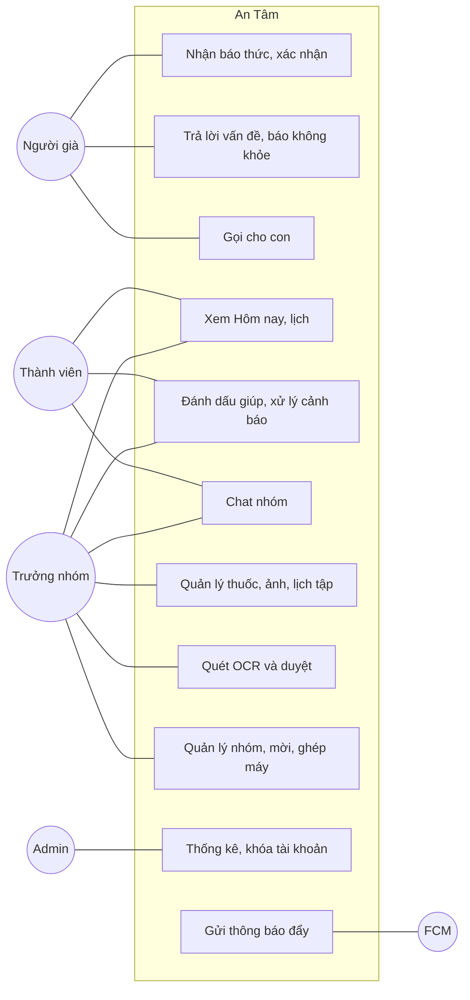
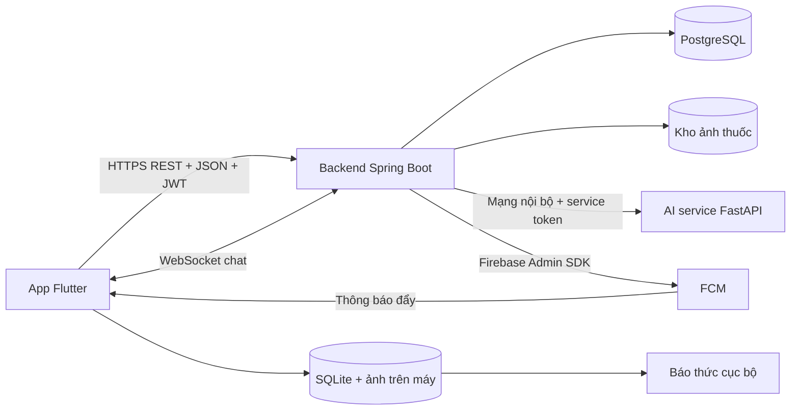
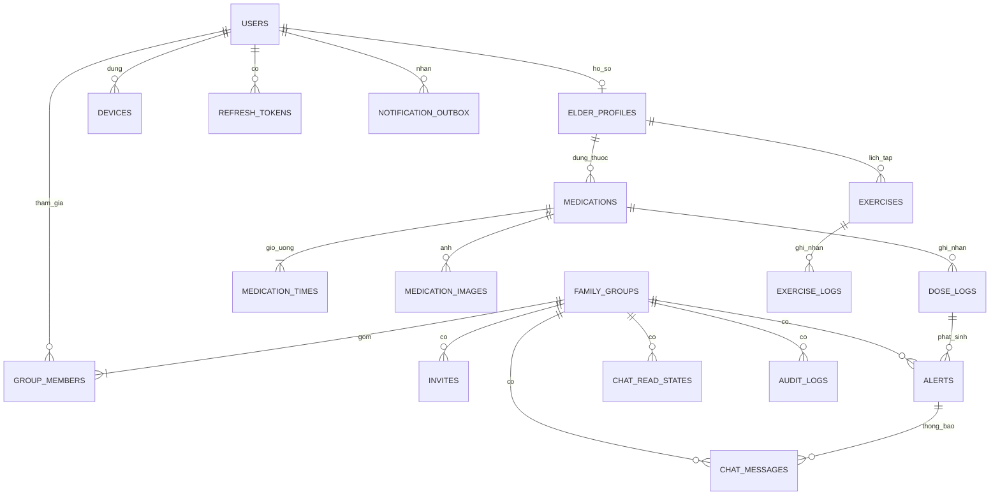
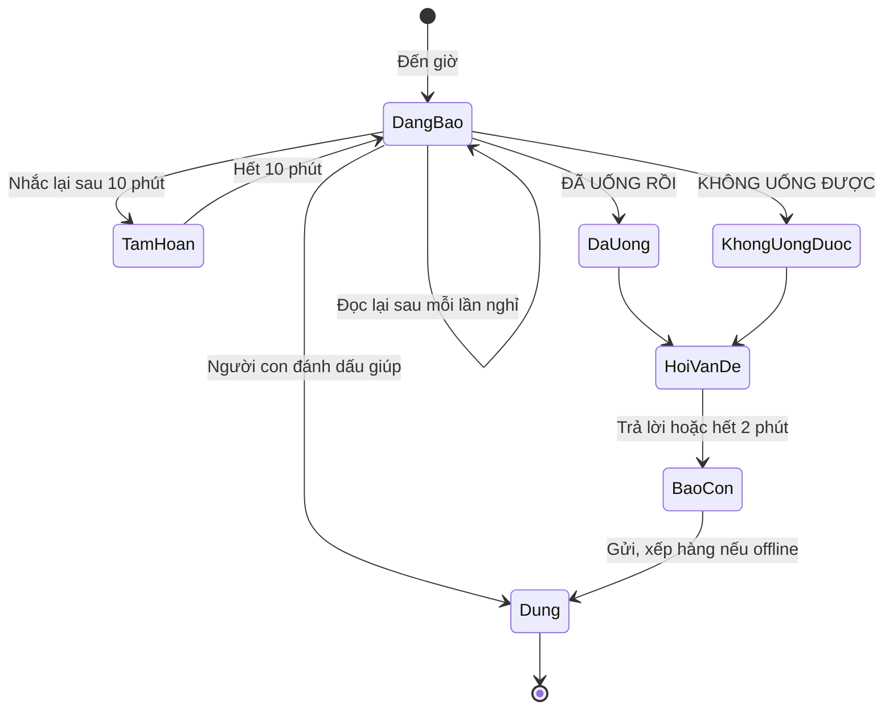

# BÁO CÁO BÀI TẬP NHÓM MÔN MOBILE APP

## AN TÂM – ỨNG DỤNG NHẮC NGƯỜI GIÀ UỐNG THUỐC VÀ THEO DÕI CÙNG GIA ĐÌNH

> **Bản nháp.** Các ô đánh dấu `[NHÓM ĐIỀN]` chỉ nhóm điền được, theo đóng góp thật. Phần kỹ thuật lấy từ mã nguồn và `docs/`; khi chuyển sang mẫu Word của môn, giữ nguyên số liệu và đối chiếu lại với `docs/TEST_REPORT.md`.

| STT | Họ tên | Phần việc chung | Phần việc cá nhân | % đóng góp |
|---|---|---|---|---|
| 1 | [NHÓM ĐIỀN] | [NHÓM ĐIỀN] | Báo thức, giọng đọc, trải nghiệm người già (mục 2.A) | [NHÓM ĐIỀN] |
| 2 | [NHÓM ĐIỀN] | [NHÓM ĐIỀN] | Tài khoản, nhóm gia đình, phân quyền, chat, thông báo, admin (mục 2.B) | [NHÓM ĐIỀN] |
| 3 | [NHÓM ĐIỀN] | [NHÓM ĐIỀN] | Quét OCR, AI, ảnh và mô tả thuốc, lịch, kiểm thử (mục 2.C) | [NHÓM ĐIỀN] |
| | | | **Tổng** | **100%** |

> Phân công trên là gợi ý theo kế hoạch; sửa theo thực tế. Nếu môn học yêu cầu khai báo công cụ hỗ trợ (ví dụ trợ lý lập trình AI), ghi rõ ở đây.

---

# PHẦN 1. CÔNG VIỆC CHUNG

## 1.1. Lý do chọn ứng dụng

Người cao tuổi thường dùng nhiều loại thuốc mỗi ngày, dễ quên giờ hoặc nhầm thuốc; con cái thường ở xa và không biết bố mẹ đã uống chưa. An Tâm giải quyết hai việc cùng lúc: điện thoại của bố mẹ **nhắc đúng giờ và nhắc đến khi được xác nhận**, còn các con **cùng theo dõi trong một nhóm gia đình**.

**So sánh với ứng dụng tương tự** `[NHÓM ĐIỀN]`: nhóm cài và dùng thử thật ít nhất 2–3 ứng dụng nhắc thuốc trên CH Play, ghi ưu, nhược điểm đã thấy. Không nhận xét về ứng dụng chưa dùng thử. Gợi ý các tiêu chí so sánh (đều đã có trong An Tâm):

| Tiêu chí | App A | App B | An Tâm |
|---|---|---|---|
| Báo khi mất mạng, sau khởi động lại | | | Có (báo thức cục bộ, lịch lưu trên máy) |
| Đọc tên và mô tả thuốc bằng tiếng Việt, lặp đến khi xác nhận | | | Có |
| Ảnh viên thuốc để phân biệt | | | Có |
| Hỏi "có vấn đề gì không" sau khi uống | | | Có (mất, hết thuốc, không khỏe...) |
| Nhiều người con cùng theo dõi, phân quyền | | | Có (nhóm gia đình, trưởng nhóm, thành viên) |
| Chat gia đình | | | Có |
| Nhập thuốc từ ảnh toa thuốc | | | Có, chữ đọc trên máy, bắt buộc duyệt |

## 1.2. Yêu cầu chức năng

| Tác nhân | Chức năng |
|---|---|
| Người già | Nhận báo thức có ảnh và giọng đọc; xác nhận đã uống hoặc không uống được (nút hoặc giọng nói); hoãn 10 phút; trả lời "có vấn đề gì không"; báo "Tôi thấy không khỏe"; gọi cho con; xem thuốc hôm nay; nhận báo tập thể dục ("TÔI ĐI TẬP ĐÂY") |
| Trưởng nhóm | Mọi quyền của thành viên; thêm, sửa, xóa thuốc, ảnh, mô tả, lịch tập; Quét OCR; thêm hồ sơ bố mẹ, tạo mã ghép máy; mời, xóa thành viên; chuyển quyền |
| Thành viên | Xem tab Hôm nay, lịch tuần/tháng, danh sách thuốc; nhận báo cáo và cảnh báo; xử lý cảnh báo; đánh dấu giúp "đã uống" và hoàn tác; chat; rời nhóm |
| Admin hệ thống | Xem số liệu tổng hợp; tìm, khóa, mở khóa tài khoản (không xem được thuốc, ảnh, chat) |
| Hệ thống (FCM, tác vụ nền) | Gửi thông báo đẩy; tạo cảnh báo "chưa xác nhận" sau 60 phút; dọn ảnh đã xóa |

## 1.3. Yêu cầu phi chức năng

- **Tin cậy:** báo đúng giờ (lệch dưới 1 phút) kể cả khi mất mạng, app đã tắt, màn hình khóa, sau khởi động lại; báo thức không phụ thuộc server hay AI.
- **Không trùng dữ liệu:** mọi xác nhận gửi lại từ hàng đợi offline đều không tạo bản ghi trùng (`client_event_id` + `UNIQUE`).
- **Dễ dùng cho người già:** chữ từ 20sp, nút cao từ 72dp, trạng thái luôn có biểu tượng + chữ + màu, dùng được với cỡ chữ 200% và TalkBack.
- **Bảo mật và riêng tư:** kiểm tra quyền trên từng đối tượng (có test cho ma trận quyền), mật khẩu BCrypt, JWT ngắn hạn + refresh token xoay vòng, HTTPS ở bản phát hành, OCR đọc chữ trên máy và lọc thông tin cá nhân, không ghi dữ liệu thuốc vào log, có màn hình đồng ý và xóa tài khoản.
- **An toàn y khoa:** không tư vấn, không đề xuất liều, OCR không suy đoán thông tin giấy tờ không ghi.

## 1.4. Biểu đồ Use Case tổng quát

## 1.5. Kiến trúc, công nghệ, mô hình

| Phần | Công nghệ | Lý do |
|---|---|---|
| App | Flutter 3.47 (Dart), Riverpod, go_router, dio, drift (SQLite) | Một mã nguồn, giao diện Material 3; SQLite giữ lịch và hàng đợi offline |
| Báo thức | Java gốc qua platform channel: `AlarmManager.setAlarmClock`, foreground service, TTS trên luồng báo thức | Thử nghiệm ở Giai đoạn 2: tin cậy hơn các gói Flutter khi app bị tắt, sau khởi động lại, ở chế độ máy bay |
| Backend | Java 25, Spring Boot 4, Spring Security (JWT), JPA, Flyway, WebSocket | Kiểu dữ liệu chặt, giao dịch, migration có kiểm soát |
| CSDL | PostgreSQL 18 | Ràng buộc `UNIQUE`, chỉ mục một phần (mỗi nhóm 1 trưởng nhóm, mỗi người già 1 nhóm) |
| AI | Python 3.13, FastAPI | Tách thông tin từ chữ OCR; chỉ backend gọi bằng service token |
| Hạ tầng | Docker Compose trên laptop + đường hầm HTTPS (cloudflared) | Không tốn phí máy chủ |

**Chat và vấn đề tải, đồng bộ:** tin nhắn đi qua REST (lưu, chống trùng bằng `client_message_id`) rồi được đẩy qua WebSocket **sau khi giao dịch commit** tới mọi phiên đã đăng ký nhóm; server kiểm tra quyền ở mỗi lần đẩy. Mất kết nối thì app tự kết nối lại (chờ 1 → 30 giây) và tải lại trang mới nhất bằng REST, nên không mất tin. Lịch sử phân trang theo con trỏ (`before=id`). Độ trễ đo trong test: 80 ms.

**Đồng bộ offline của máy người già:** lịch 7 ngày tới được tải về SQLite và đặt báo thức cục bộ; mọi câu trả lời được ghi ngay trên máy và vào hàng đợi, gửi lại đến khi server nhận (server bỏ qua bản trùng). Thông báo cho người con đi qua `notification_outbox` (ghi trong cùng giao dịch, khóa chống trùng), nên laptop tắt rồi bật vẫn gửi bù.

## 1.6. Lưu trữ và ERD

- **PostgreSQL** (backend): tài khoản, nhóm, thuốc, lịch tập, nhật ký uống, cảnh báo, chat, hàng đợi thông báo, audit. Thời điểm lưu UTC; giờ uống là giờ địa phương theo múi giờ của người già.
- **SQLite trên máy người già:** thuốc, ảnh (file), lịch tập, nhật ký uống trên máy, hàng đợi sự kiện chờ gửi.
- **Kho ảnh:** thư mục trong Docker volume, ảnh được nén lại và xóa EXIF; chỉ tải qua API có kiểm tra quyền.

Migration: `backend/src/main/resources/db/migration/V1` → `V7`.

## 1.7. Nội dung mới, khó và hướng phát triển

**Điểm mới:** ảnh và mô tả giúp người già phân biệt thuốc; báo liên tục kèm giọng đọc và hỏi lại vấn đề sau khi uống; nhóm gia đình phân quyền kiểu nhóm chat (một người con ở nhiều nhóm, mỗi người già một nhóm, mỗi nhóm một trưởng nhóm); người con đánh dấu giúp làm máy bố mẹ ngừng báo; OCR đọc trên máy, lọc thông tin cá nhân, không tự bịa liều và giờ.

**Điểm khó đã giải quyết:** báo thức tin cậy trên Android (Doze, khởi động lại, foreground service); đồng bộ offline không trùng; OCR tiếng Việt (lỗi đọc "50Omg" thành chữ O đã được xử lý); chat thời gian thực có kiểm tra quyền mỗi lần gửi; khóa tài khoản có hiệu lực ngay.

**Hướng phát triển:** thử LLM/mô hình cho OCR khi nhóm đồng ý (bộ đánh giá đã sẵn); nghe giọng nói tự động giữa các lượt đọc; iPhone; nhiều múi giờ; thống kê tuân thủ theo tháng.

**Kết quả kiểm thử:** backend 89 test, app 84 test, AI service 26 test, tất cả đạt; chi tiết theo từng giai đoạn trong `docs/TEST_REPORT.md`. Chưa thử: Samsung thật, người dùng từ 55 tuổi ngoài nhóm, thông báo đẩy thật (cần Firebase).

---

# PHẦN 2. PHẦN VIỆC CỦA TỪNG THÀNH VIÊN

## 2.A. [NHÓM ĐIỀN tên] – Báo thức, giọng đọc, trải nghiệm người già

**Chức năng và luồng:**

**Ràng buộc nghiệp vụ:** chỉ dừng khi người già trả lời, hoãn, hoặc người con đánh dấu giúp; câu có "chưa"/"không" không bao giờ tính là đã uống; quá 60 phút chưa xác nhận thì báo người con là "chưa xác nhận" (không khẳng định đã quên); nhiều thuốc cùng giờ gộp một màn hình; bài tập cùng cơ chế với nút TÔI ĐI TẬP ĐÂY.

**Giao diện:** trang chính chữ lớn (`docs/screenshots/phase5-elder-home.png`), màn hình báo nhiều thuốc (`phase5-alarm-multi.png`), câu hỏi vấn đề (`phase5-question.png`), báo tập (`phase7-exercise-alarm.png`), kiểm tra máy (`phase5-readiness.png`).

**Giải pháp kỹ thuật:** `app/android/.../alarm/` (AlarmScheduler, AlarmService, RearmReceiver), `app/lib/reminder/` (schedule_db, schedule_sync, outbox, elder_schedule), `app/lib/features/elder/`. Id báo thức mã hóa phút nên màn hình báo tìm được thuốc cần uống ngay cả khi offline.

**Điểm khó:** Android hủy báo thức khi bị "force stop"; Samsung tối ưu pin; giọng tiếng Việt có thể chưa cài (không đọc bằng giọng tiếng Anh).

## 2.B. [NHÓM ĐIỀN tên] – Tài khoản, nhóm, phân quyền, chat, thông báo, admin

**Chức năng:** đăng ký, đăng nhập, refresh token xoay vòng; nhóm, mời bằng mã, ghép máy người già bằng mã 6 số (15 phút, dùng 1 lần, giới hạn số lần thử); chuyển quyền, rời nhóm; tab Hôm nay, đánh dấu giúp; chat; thông báo đẩy qua outbox; admin.

**Ràng buộc:** ma trận quyền mục 5 của kế hoạch, có test tích hợp cho từng ô (`GroupAuthorizationTest`, `CareTest`, `TodayTest`, `ChatTest`, `AdminTest`). Người ngoài nhóm nhận 404 để không dò được id nhóm.

**Giao diện:** tab Hôm nay (`phase6-today.png`), chat (`phase9-chat.png`).

**Giải pháp kỹ thuật:** `backend/.../group`, `auth`, `care`, `chat`, `notification`, `admin`; `app/lib/features/caregiver`, `chat`, `admin`.

**Điểm khó:** chống trùng khi nhiều bản gửi đến cùng lúc (ràng buộc `UNIQUE` + thử lại); đẩy tin chat sau commit; khóa tài khoản có hiệu lực trước khi token hết hạn.

## 2.C. [NHÓM ĐIỀN tên] – Quét OCR, AI, ảnh thuốc, lịch, kiểm thử

**Chức năng:** thêm, sửa, xóa thuốc (đánh phiên bản để giữ lịch sử), ảnh viên thuốc và bao bì, mô tả; Quét OCR 4 loại giấy tờ với màn hình duyệt bắt buộc; lịch tuần, tháng; lịch tập.

**Luồng OCR:** chọn loại → chụp/chọn ảnh → cắt → ML Kit đọc trên máy → lọc dòng cá nhân → backend → AI service → duyệt → tạo thuốc.

**Ràng buộc:** không có đường tạo thuốc nào bỏ qua duyệt; không suy đoán liều, giờ khi giấy không ghi; không ghi nội dung giấy tờ vào log; AI lỗi thì nhập tay.

**Kết quả đo:** `ai-service/evaluation/REPORT.md` (32 mẫu tự soạn; nhóm test: toa thuốc 12/12 thuốc đúng mọi trường, bao bì 4/5, hóa đơn 6/8, 0 lần tự bịa).

**Giao diện:** màn hình duyệt (`phase8-review.png`), lịch tháng (`phase7-month.png`).

**Giải pháp kỹ thuật:** `ai-service/app/parsing/`, `backend/.../ocr`, `medication`, `exercise`; `app/lib/features/ocr`, `medications`, `exercises`, `caregiver/schedule_tab.dart`; bộ dữ liệu kiểm thử dùng chung `shared/test-vectors/` chạy ở cả Dart và Java.

**Điểm khó:** chữ tiếng Việt có/không dấu, lỗi nhận dạng chữ/số; trạng thái một lần nhắc phải giống nhau ở app và server.
